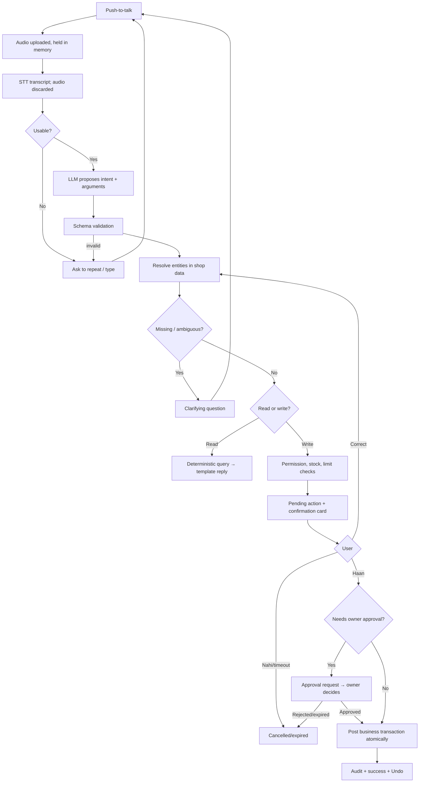

# Munim AI — Software Requirements Specification (SRS)

| Field | Value |
|---|---|
| Document | Software Requirements Specification |
| Product | Munim AI — voice-first business manager for kirana shops |
| Version | 0.2 (Phase 1 — revised with finalized product decisions) |
| Date | 2026-11-18 |
| Status | Ready for Phase 1 approval |
| Related | [architecture.md](architecture.md), [database-design.md](database-design.md), [risk-analysis.md](risk-analysis.md) |

> **Reading convention.** **[DECIDED]** marks a product decision confirmed by the stakeholder on 2026-11-18. **[ASSUMPTION]** marks an architect's default that still awaits confirmation but does not block Phase 2. **[OPEN]** marks an unresolved question (§13).

### Changes since v0.1

| Area | Change |
|---|---|
| Authentication | Phone + password with Argon2id; OTP deferred (FR-AUTH) |
| Multi-shop | Data model supports many shops per owner; one active shop in UI; switching designed (FR-SHOP) |
| Reminders | Pre-filled WhatsApp links sent manually by the owner; no WhatsApp Business API (FR-NOTIF) |
| Reports | The word "kamai" is banned for metrics; seven separately defined metrics (FR-REP-01) |
| Sales | Unitemized sales allowed without stock deduction; partial cash/credit sales; payment allocation (FR-SALE, FR-CRED) |
| Stock | Insufficient-stock sales blocked by default; owner override with reason (FR-INV-06) |
| Approvals | Owner approval for staff udhaar above limit (FR-APPR) |
| Voice | Raw audio never retained (FR-VOICE-17, NFR-SEC-07) |
| Pilot | 5–10 shops, Hindi, Hinglish, Punjabi |
| Questions | Resolved questions removed; new genuinely open questions added (§13) |

---

## 1. Introduction

### 1.1 Problem statement

India has an estimated 12+ million kirana stores. Most run their business from a handwritten *bahi-khata* and the owner's memory:

- **Sales** are rarely recorded item by item; the owner knows takings only roughly from the cash box.
- **Inventory** is tracked by looking at shelves; stock-outs are discovered when a customer asks.
- **Udhaar** is written in a notebook in shorthand, sometimes by different family members; disputes are common and money is forgotten.
- **Expenses** are mixed with personal spending, so real profit is unknown.
- **Supplier orders** are placed by phone from memory.

Existing billing apps assume comfort with typing, English menus and forms, while the shopkeeper is standing at a counter serving customers with one hand busy.

### 1.2 Purpose of this document

This SRS defines what Munim AI must do and how well, for the product owner, developers, testers and contributors. It is the baseline for [architecture.md](architecture.md) and [database-design.md](database-design.md).

### 1.3 Product vision

> *"Bolo, aur hisaab ho gaya."* — Speak naturally, and the books are kept.

A responsive **web application** where the shopkeeper speaks in Hindi, Hinglish or Punjabi. The system understands the request, turns it into a precise, validated operation, reads it back for confirmation, and only then records it.

### 1.4 Scope

**In scope:** 12 modules — authentication and shop management, products, sales, inventory, customers, udhaar, expenses, suppliers, purchase orders, voice assistant, reports, reminders — plus owner approvals and audit, as a responsive website.

**Out of scope:**

- Native Android/iOS apps, React Native, Expo.
- OTP login and OTP-based password recovery (later phase) **[DECIDED]**.
- WhatsApp Business API or SMS gateway messaging (later phase) **[DECIDED]**.
- GST invoicing and tax filing **[OPEN — Q-04]**.
- Payment processing (Munim AI *records* payments; it does not move money).
- Lending, credit scoring or any regulated financial service.
- Multi-branch chain management; barcode hardware.

### 1.5 Pilot

**[DECIDED]** Initial pilot with **5–10 kirana shops**, languages **Hindi, Hinglish and Punjabi**.

### 1.6 Definitions

| Term | Meaning |
|---|---|
| Kirana | Small neighbourhood retail store |
| Udhaar | Goods/money given on credit, to be paid later |
| Shop / Tenant | One business; all business data belongs to exactly one shop |
| Business transaction | One recorded business operation (sale, collection, expense, adjustment, reversal…) and all ledger rows it produced |
| Itemized sale | A sale with product lines; deducts stock |
| Unitemized sale | An amount-only sale ("2000 ka saaman becha"); no product lines, no stock deduction |
| Paid-now amount | Part of a sale paid at the time of sale (cash/UPI) |
| Credit portion | Part of a sale added to the customer's udhaar |
| Allocation | Assignment of a customer payment to specific earlier udhaar entries |
| Advance | Money paid by a customer beyond what they owe (negative balance) |
| Reversal | A new, linked transaction that exactly cancels an earlier one; the original is never edited |
| Override | An owner-authorized exception to a business rule, with a recorded reason |
| Approval request | A staff operation waiting for owner approval |
| Intent | The business operation a voice command asks for |
| Pending action | A resolved, validated operation proposed by the voice pipeline, awaiting confirmation |
| Paise | 1/100 rupee; the storage unit for all money |
| Idempotency key | Client-generated unique key that makes a repeated request harmless |

---

## 2. Overall description

### 2.1 Target users

| Persona | Description | Key needs | Constraints |
|---|---|---|---|
| **Shop owner** — primary | Runs a 1–3 person kirana; may own more than one shop; comfortable with WhatsApp and UPI, uncomfortable with forms and English | Today's numbers, who owes money, what to reorder; record in seconds | Noisy shop, patchy 4G, low-end phone, one free hand |
| **Staff / family helper** | Serves customers | Record sales and udhaar quickly; check stock | Limited permissions; udhaar above their limit needs owner approval |
| **Platform administrator** (internal) | Munim AI operations | Onboarding, support, abuse handling | Must not casually browse shop financial data |

### 2.2 Objectives

| # | Objective | Target |
|---|---|---|
| O1 | Faster than the notebook | Simple sale or udhaar by voice in ≤ 10 s including confirmation |
| O2 | Never record wrong money silently | 0 voice writes without confirmation; 100 % of financial records auditable |
| O3 | Recover forgotten udhaar | Accurate customer balances and ageing at all times |
| O4 | Prevent stock-outs and phantom stock | Low-stock alerts; no stock below zero without a recorded override |
| O5 | Honest business numbers | Seven clearly defined summary metrics; no ambiguous "kamai" |
| O6 | Accessible to low-literacy users | Core flows usable without typing |
| O7 | Trust and privacy | Strict shop isolation; raw audio never retained |

### 2.3 Operating environment

Chrome for Android (primary), Samsung Internet, Safari iOS 16+, desktop browsers; 2 GB RAM / 360 px phones; 3G/4G with drops; HTTPS required (browser microphone access). Backend on Linux containers with PostgreSQL 15+ in an India cloud region (provider to be chosen, §13 Q-13).

### 2.4 Design and implementation constraints

1. Web application only; responsive; mobile-first.
2. Frontend: Next.js (App Router), React, TypeScript, Tailwind CSS.
3. Backend: Python, FastAPI, Pydantic, SQLAlchemy 2.0, Alembic; modular monolith.
4. Database: PostgreSQL with Row-Level Security.
5. AI (later phase): Sarvam Saaras (STT), GPT with tool calling, Sarvam Bulbul (TTS), behind replaceable adapters.
6. The LLM never writes to the database.
7. Secrets only from environment / secret manager.

---

## 3. User roles and permissions

### 3.1 Roles

| Role | Scope | Description |
|---|---|---|
| **Owner** | One or more shops (one membership per shop) | Full control of each shop they own |
| **Staff** | One shop per membership | Day-to-day operations within owner-set limits |
| **Platform Admin** | Platform | Shop account management; no routine access to shop business data |

Roles are held per shop through memberships **[DECIDED: multi-shop data model]**. The MVP dashboard works with **one active shop**; the backend supports switching the active shop, and the switcher UI is future work.

### 3.2 Permission matrix (MVP)

| Capability | Owner | Staff | Platform Admin |
|---|:-:|:-:|:-:|
| Record sale (itemized or unitemized) | ✅ | ✅ | ❌ |
| Sell beyond available stock | ✅ with reason (override) | 🔶 request owner approval | ❌ |
| Give udhaar up to staff limit | ✅ (no limit) | ✅ | ❌ |
| Give udhaar above staff limit | ✅ | 🔶 request owner approval | ❌ |
| Record udhaar payment / allocation | ✅ | ✅ | ❌ |
| Approve/reject staff requests | ✅ | ❌ | ❌ |
| View customer balances | ✅ | ✅ | ❌ |
| Add/edit products and prices | ✅ | ⚙️ configurable | ❌ |
| Stock adjustment / stock count | ✅ | ❌ | ❌ |
| Record expense | ✅ | ⚙️ configurable | ❌ |
| Create/send purchase orders, receive goods | ✅ | ⚙️ configurable (receive allowed by default) | ❌ |
| Reverse a transaction | ✅ | ❌ (own entry within 5 min **[ASSUMPTION]**) | ❌ |
| Write off udhaar | ✅ | ❌ | ❌ |
| View profit and reports | ✅ | ❌ | ❌ |
| Generate WhatsApp reminder links | ✅ | ❌ | ❌ |
| Manage staff, limits, settings | ✅ | ❌ | ❌ |
| View audit trail | ✅ | ❌ | Platform events only |
| Suspend shop | ❌ | ❌ | ✅ |

All permissions are enforced on the backend. The voice assistant acts with exactly the logged-in user's permissions.

---

## 4. Functional requirements

Priority: **M** Must (MVP), **S** Should, **C** Could, **F** Future. Voice is an input method over the same operations as the manual UI.

### 4.1 Authentication and shop management

| ID | Requirement | Pri |
|---|---|---|
| FR-AUTH-01 | Owner registers with mobile number, name and password **[DECIDED]** | M |
| FR-AUTH-02 | Login with mobile number + password. Error messages never reveal whether a number is registered | M |
| FR-AUTH-03 | Passwords hashed with **Argon2id** (per-password salt, parameters stored with the hash, rehash on login when parameters are upgraded). Plaintext passwords are never stored or logged **[DECIDED]** | M |
| FR-AUTH-04 | Password policy: minimum 8 characters, maximum 128; checked against a common-password list; no forced composition rules | M |
| FR-AUTH-05 | Rate limiting on login per phone number and per IP; progressive lockout after repeated failures (e.g. 5 failures → increasing delay) **[DECIDED: rate limiting]** | M |
| FR-AUTH-06 | Secure sessions: short-lived access token + rotating refresh token in an httpOnly, Secure, SameSite cookie; refresh-token reuse detection; list and revoke devices; "log out everywhere" | M |
| FR-AUTH-07 | Change password (requires current password); all other sessions are revoked | M |
| FR-AUTH-08 | Owner creates staff accounts (phone + temporary password); staff must change the password at first login; owner can reset a staff password | M |
| FR-AUTH-09 | Owner self-service password recovery — **deferred** until OTP. Interim process: **[OPEN — Q-18]** | — |
| FR-AUTH-10 | OTP verification of phone numbers | F |
| FR-SHOP-01 | Owner creates a shop: name, address, city, language, business type, timezone (default Asia/Kolkata) | M |
| FR-SHOP-02 | An owner can create/own **multiple shops**; each shop's data is fully isolated **[DECIDED]** | M (data model) |
| FR-SHOP-03 | The session has exactly one **active shop**; at login it defaults to the last active shop | M |
| FR-SHOP-04 | Backend endpoint to switch the active shop (membership verified; new token issued) | S |
| FR-SHOP-05 | Shop switcher UI | F |
| FR-SHOP-06 | Owner adds staff, sets role, permission overrides and **staff credit limit** | M |
| FR-SHOP-07 | Owner deactivates staff immediately (sessions revoked) | M |
| FR-SHOP-08 | Shop settings: confirmation thresholds, default staff credit limit, approval-request expiry, low-stock defaults, reminder template | S |
| FR-SHOP-09 | Starter product catalogue by business type | S |

### 4.2 Product management

| ID | Requirement | Pri |
|---|---|---|
| FR-PROD-01 | Create/edit/archive products: name, category, base unit, **selling price**, optional **default cost price**, reorder level | M |
| FR-PROD-02 | Multiple aliases per product for voice and search | M |
| FR-PROD-03 | Units with conversions: kg, g, litre, ml, piece, packet, dozen, box | M |
| FR-PROD-04 | Decimal quantities for loose items; integers for count items | M |
| FR-PROD-05 | Price history retained; past sales keep their snapshot prices and costs | M |
| FR-PROD-06 | **Weighted-average cost** maintained automatically from goods receipts; the default cost price is used only until the first receipt **[ASSUMPTION — Q-19]** | M |
| FR-PROD-07 | Products referenced by transactions are archived, never deleted | M |
| FR-PROD-08 | Barcode field | C |

### 4.3 Sales management

| ID | Requirement | Pri |
|---|---|---|
| FR-SALE-01 | **Itemized sale** with one or more product lines (product, quantity, unit, unit price, line total) | M |
| FR-SALE-02 | Default unit price = current selling price; overridable | M |
| FR-SALE-03 | Payment split per sale: any combination of cash, UPI and **credit (udhaar)**, e.g. ₹500 cash + ₹250 udhaar; Σ parts must equal the total | M |
| FR-SALE-04 | A sale with a credit portion must have a customer; the credit portion becomes an udhaar entry in the same atomic transaction | M |
| FR-SALE-05 | An itemized sale deducts stock for each line atomically, and snapshots each line's cost for profit calculation | M |
| FR-SALE-06 | **Unitemized sale** (amount only) allowed; **does not deduct inventory**; marked "unitemized" everywhere it appears and excluded from gross profit **[DECIDED]** | M |
| FR-SALE-07 | Bill-level and line-level discounts (amount) | S |
| FR-SALE-08 | Sales cannot be edited; corrections are **reversals** linked to the original, restoring stock, cancelling the credit portion, and optionally recording a cash refund or keeping it as customer advance (owner chooses) | M |
| FR-SALE-09 | Sales list filtered by date, type (itemized/unitemized), payment mode, customer, status (active/reversed) | M |
| FR-SALE-10 | Digital receipt as shareable text | C |

### 4.4 Inventory management

| ID | Requirement | Pri |
|---|---|---|
| FR-INV-01 | Every stock change is an immutable stock movement (opening, sale, sale reversal, purchase receipt, adjustment: damage/expiry/loss/count, return to supplier) | M |
| FR-INV-02 | Current stock = Σ movements (cached, verified nightly) | M |
| FR-INV-03 | Opening stock entry during onboarding and later | M |
| FR-INV-04 | Physical stock count: records system quantity, counted quantity and difference, then posts the adjustment; Owner only | M |
| FR-INV-05 | Low-stock list (stock ≤ reorder level) | M |
| FR-INV-06 | **Insufficient stock:** a sale line exceeding available stock is **blocked by default**. An **owner** may override with a mandatory reason (stock not entered / count error / other + note); staff may request an owner override through an approval request. Overrides are recorded on the transaction, and stock may then go negative, which flags the product for counting **[DECIDED]** | M |
| FR-INV-07 | Voice stock query | M |
| FR-INV-08 | Batch/expiry tracking | F |

### 4.5 Customer management

| ID | Requirement | Pri |
|---|---|---|
| FR-CUST-01 | Create/edit/archive customers: name, nicknames, phone, landmark, notes | M |
| FR-CUST-02 | Duplicate names allowed; distinguished by nickname, landmark and phone | M |
| FR-CUST-03 | Profile shows balance, open udhaar entries with age, ledger, payments, recent purchases | M |
| FR-CUST-04 | Reminder consent flag | M |
| FR-CUST-05 | Search by name/nickname/phone across scripts with phonetic matching | M |

### 4.6 Udhaar, payments and allocation

| ID | Requirement | Pri |
|---|---|---|
| FR-CRED-01 | Record udhaar given (standalone or as a sale's credit portion) | M |
| FR-CRED-02 | Record **opening udhaar balances** when migrating from the notebook | M |
| FR-CRED-03 | Record payments from customers, including **partial payments** of any amount | M |
| FR-CRED-04 | **Payment allocation:** each payment is allocated to open udhaar entries — **oldest first by default**; in the manual UI the user may select specific entries | M |
| FR-CRED-05 | Overpayment is held as a customer **advance** (negative balance) and automatically applied to the next udhaar | M |
| FR-CRED-06 | The udhaar ledger is append-only; corrections are reversals | M |
| FR-CRED-07 | Customer balance = Σ udhaar ledger, computed by deterministic backend logic | M |
| FR-CRED-08 | Outstanding list sortable by amount and by age of the oldest open entry; ageing buckets 0–30/31–60/61–90/90+ days | M |
| FR-CRED-09 | Per-customer credit limit with warning | S |
| FR-CRED-10 | Owner write-off of a balance with a reason (audited; reduces estimated net profit) | S |
| FR-CRED-11 | Customer statement as shareable text | C |

### 4.7 Owner approvals

| ID | Requirement | Pri |
|---|---|---|
| FR-APPR-01 | When staff attempt udhaar above their configured credit limit, the operation is **not posted**; an approval request is created for the owner(s) **[DECIDED]** | M |
| FR-APPR-02 | Staff can also request an insufficient-stock override (FR-INV-06) | M |
| FR-APPR-03 | Owners see pending requests in-app with full details: customer identity, amount, current and resulting balance, requester, time | M |
| FR-APPR-04 | Owner approves or rejects (optional note); approval re-validates the operation and posts it atomically, recording requester and approver | M |
| FR-APPR-05 | Requests expire (default: end of the business day **[ASSUMPTION]**); nothing is posted on rejection or expiry; the requester is notified | M |
| FR-APPR-06 | The requester cannot approve their own request | M |

### 4.8 Expense management

| ID | Requirement | Pri |
|---|---|---|
| FR-EXP-01 | Record expense: amount, category, mode, date, note | M |
| FR-EXP-02 | Custom categories | S |
| FR-EXP-03 | Category kind: business expense vs owner's personal withdrawal ("ghar kharch"); personal withdrawals are excluded from profit | M |
| FR-EXP-04 | Corrections by reversal | M |

### 4.9 Supplier management

| ID | Requirement | Pri |
|---|---|---|
| FR-SUPP-01 | Create/edit/archive suppliers | M |
| FR-SUPP-02 | Link products to usual suppliers | S |
| FR-SUPP-03 | Supplier payable ledger | **[OPEN — Q-08]** |

### 4.10 Purchase orders

| ID | Requirement | Pri |
|---|---|---|
| FR-PO-01 | Draft purchase order with items | M |
| FR-PO-02 | Reorder suggestions from low stock and sales velocity | S |
| FR-PO-03 | Lifecycle: draft → sent → partially received → received / cancelled | M |
| FR-PO-04 | Goods receipt against a PO (partial allowed; actual quantity and cost) creates stock movements and updates average cost atomically | M |
| FR-PO-05 | Goods receipt without a PO (mandi/walk-in supplier) | M |
| FR-PO-06 | Share the PO as WhatsApp text / printable view | S |
| FR-PO-07 | Voice "agle hafte ka samaan mangwana hai" only creates a **draft** | M |

### 4.11 Voice assistant

| ID | Requirement | Pri |
|---|---|---|
| FR-VOICE-01 | Push-to-talk mic on every main screen | M |
| FR-VOICE-02 | Hindi, Hinglish, Punjabi **[DECIDED]** | M |
| FR-VOICE-03 | Transcript always shown | M |
| FR-VOICE-04 | Classify into a supported intent (§5.2) or say it can't do that | M |
| FR-VOICE-05 | Entities resolved by the backend against the shop's own data | M |
| FR-VOICE-06 | Clarifying questions for missing/ambiguous details | M |
| FR-VOICE-07 | All writes become pending actions shown as a confirmation card and spoken; executed only after confirmation | M |
| FR-VOICE-08 | Read-only queries answered without confirmation | M |
| FR-VOICE-09 | Pending actions expire (default 2 min **[ASSUMPTION]**) | M |
| FR-VOICE-10 | Cancel or correct before confirming | M |
| FR-VOICE-11 | Spoken replies via TTS, with mute | M |
| FR-VOICE-12 | Multi-item sale commands | S |
| FR-VOICE-13 | Structured log of each interaction: transcript (time-limited), intent, arguments, outcome, confirmation status | M |
| FR-VOICE-14 | "Undo last" → reversal, with confirmation | S |
| FR-VOICE-15 | Every voice operation is also available in the manual UI | M |
| FR-VOICE-16 | Typed text fallback | S |
| FR-VOICE-17 | **Raw audio is processed in memory and discarded after transcription. It is never written to disk, object storage, the database or logs** **[DECIDED]** | M |
| FR-VOICE-18 | A staff voice command over the credit limit, or over available stock, routes into the approval flow (FR-APPR) after confirmation | M |

### 4.12 Reports and business summary

**[DECIDED]** The word **"kamai"** (or "earnings") is **never** used as the label for a metric. When a user asks "aaj kitni kamai hui?", the assistant shows the full business summary below rather than a single number.

| ID | Requirement | Pri |
|---|---|---|
| FR-REP-01 | Business summary for a period (today / date / range) showing these metrics **separately**, each with an on-screen definition: | M |
| | • **Total sales** — Σ active sales (itemized + unitemized), including credit portions | |
| | • **Cash collected** — all money received in the period (cash + UPI, shown split) from sales paid now *and* udhaar collections, minus refunds | |
| | • **Credit sales** — Σ credit portions of sales in the period | |
| | • **Outstanding credit** — total udhaar owed by all customers at the end of the period (advances shown separately) | |
| | • **Expenses** — Σ business expenses (excluding personal withdrawals) | |
| | • **Gross profit** — Σ (line revenue − snapshot cost) over itemized lines with known cost; shown with **cost coverage %** | |
| | • **Estimated net profit** — gross profit − business expenses − udhaar write-offs; always labelled "estimated" | |
| FR-REP-02 | Unitemized sales are shown as a separate figure and noted as excluded from profit **[DECIDED]** | M |
| FR-REP-03 | Sales lines with unknown cost are excluded from gross profit and counted in the coverage indicator | M |
| FR-REP-04 | Daily cash view: opening cash (optional), cash in, cash out (expenses, refunds), expected cash in hand | S |
| FR-REP-05 | Top-selling / slow-moving products | S |
| FR-REP-06 | Udhaar ageing report | S |
| FR-REP-07 | Reversed transactions listed separately in reports (date treatment **[OPEN — Q-17]**) | M |
| FR-REP-08 | CSV/PDF export | C |

### 4.13 Reminders and notifications

| ID | Requirement | Pri |
|---|---|---|
| FR-NOTIF-01 | In-app notifications: low stock, approval requests (new/decided), POs due | M |
| FR-NOTIF-02 | **WhatsApp reminder link:** for a customer with a balance, generate a pre-filled `wa.me` link containing a polite reminder with shop name and amount; the **owner taps it and sends it manually** from their own WhatsApp **[DECIDED]** | M |
| FR-NOTIF-03 | Bulk reminders by voice/UI ("jinka 1000 se zyada udhaar hai"): system shows the exact list (and excluded customers with reasons), then produces a list of links for the owner to tap one by one | M |
| FR-NOTIF-04 | Only customers with consent and a valid phone; at most one reminder per customer per configurable period (default 3 days **[ASSUMPTION]**) | M |
| FR-NOTIF-05 | Record of reminders generated/opened/marked sent | S |
| FR-NOTIF-06 | Automated sending via WhatsApp Business API / SMS | F |

### 4.14 Audit

| ID | Requirement | Pri |
|---|---|---|
| FR-AUD-01 | Every financial or stock operation is recorded as a business transaction with initiator, approver (if any), override (if any), source (manual/voice/system), time and reason where required | M |
| FR-AUD-02 | Every create/reverse/override/approval/settings/role/price change writes an append-only audit entry with before/after values (sensitive fields masked) and request id | M |
| FR-AUD-03 | Owner can view the full history of any record, including linked reversals | S |

---

## 5. Use cases

### 5.1 Use-case list

| ID | Use case | Actor |
|---|---|---|
| UC-01 | Register, log in, create shop | Owner |
| UC-02 | Add staff and set credit limit | Owner |
| UC-03 | Record an itemized sale by voice | Owner/Staff |
| UC-04 | Give udhaar by voice | Owner/Staff |
| UC-05 | Record a partial / old-dues payment | Owner/Staff |
| UC-06 | Query stock by voice | Owner/Staff |
| UC-07 | View business summary | Owner |
| UC-08 | Generate bulk WhatsApp reminder links | Owner |
| UC-09 | Draft a reorder PO by voice | Owner |
| UC-10 | Receive goods | Owner/Staff |
| UC-11 | Record an expense | Owner |
| UC-12 | Reverse a wrong entry | Owner |
| UC-13 | Stock count correction | Owner |
| UC-14 | Approve a staff request | Owner |
| UC-15 | Record an unitemized sale | Owner/Staff |
| UC-16 | Switch active shop (backend; UI future) | Owner |

### 5.2 Voice intents (MVP)

| Intent | Example | Type | Confirmation |
|---|---|---|---|
| `record_sale` | "Aaj 5 kilo chini bechi" | Write | Required |
| `record_unitemized_sale` | "Aaj 2000 ka saaman becha" | Write | Required |
| `give_credit` | "Ramesh ko 500 ka udhaar" | Write | Always; may escalate to approval |
| `record_payment` | "Suresh ne 300 jama kiye" | Write | Always |
| `record_expense` | "Bijli ka bill 1200 diya" | Write | Required |
| `receive_stock` | "Aaj 20 kilo aata aaya" | Write | Required |
| `query_stock` | "Doodh ka stock kitna bacha hai?" | Read | No |
| `query_business_summary` | "Aaj kitni kamai hui?" / "Aaj ka hisaab batao" | Read | No — returns the full summary (FR-REP-01) |
| `query_customer_balance` | "Ramesh ka kitna udhaar hai?" | Read | No |
| `list_outstanding` | "Kis kis ka udhaar baaki hai?" | Read | No |
| `generate_reminders` | "Jinka 1000 se zyada udhaar hai unko reminder bhejo" | Prepare links | Owner reviews the list; links are sent manually |
| `draft_purchase_order` | "Agle hafte ka samaan mangwana hai" | Write (draft) | Review before sending |
| `undo_last` | "Pichhli entry cancel karo" | Write (reversal) | Always |
| `unsupported` | other | — | Polite reply |

### 5.3 Detailed use cases

#### UC-03 — Record an itemized sale by voice
**Main flow:** (1) record audio → (2) backend STT, transcript shown, audio discarded → (3) LLM proposes `record_sale{items:[{product_text:"chini", qty:5, unit_text:"kilo"}]}` → (4) backend validates, resolves "chini" → *Sugar (loose)*, converts units, fetches price ₹44/kg, computes ₹220, checks stock (12 kg available) and permission → (5) pending action, confirmation "5 kg chini, ₹220. Payment: cash. Sahi hai?" → (6) "haan" → (7) one DB transaction posts the sale, sale item with cost snapshot, stock movement, payment, audit → (8) success + Undo.

**Alternates:** A1 unknown product → offer to create; A2 multiple matches → ask; A3 spoken price used, flagged if far from list price; A4 correction → superseding pending action; A5 cancel/timeout → nothing written; **A6 insufficient stock → blocked:** "Stock mein sirf 2 kg chini hai." Owner: "Override karna hai? Reason?" Staff: "Owner se approval maangu?"; A7 split payment: "300 cash, baaki udhaar Ramesh ke khate mein" → credit portion requires the customer.

**Exceptions:** STT failure → repeat/typed fallback; network loss after confirm → retry with same idempotency key.

#### UC-04 — Give udhaar by voice
LLM proposes `give_credit{customer_text:"Ramesh", amount:500}` → backend resolves the customer; confirmation shows name + nickname/landmark + masked phone + **current → new balance** → confirm → post. **A1** several matches → disambiguate. **A2** new customer → explicit creation step. **A3 staff above limit:** after the staff member confirms, the system replies "Yeh aapki limit (₹1,000) se zyada hai. Owner ko approval ke liye bheja gaya." and creates an approval request (UC-14). Udhaar is **always** confirmed.

#### UC-05 — Record a partial or old-dues payment
"Ramesh ne 800 diye" → confirmation: "Ramesh (doodh wale) se ₹800 mile. Baaki ₹900 rahega. Pakka?" → post payment; allocate FIFO to the oldest open entries. In the manual UI the user may choose specific entries ("10 Nov wala"). If the payment exceeds the balance: "₹100 advance mein jama rahega."

#### UC-07 — View business summary
"Aaj kitni kamai hui?" → `query_business_summary{period:today}` → backend computes the seven metrics (FR-REP-01) in the shop timezone → screen shows each metric labelled and defined; TTS reads a short template: "Aaj kul bikri ₹8,450. Haath mein aaya ₹7,300. Udhaar mein gaya ₹1,150. Kharcha ₹600. Andaazit munafa ₹1,900." No LLM-generated numbers.

#### UC-08 — Generate bulk WhatsApp reminder links
Deterministic query: balance > ₹1,000 (strictly greater, shown explicitly), consent, valid phone, not reminded in the cap period → owner reviews the list, exclusions and message preview → owner taps **Bhejo** next to each customer → WhatsApp opens with the pre-filled message → owner presses send in WhatsApp → Munim AI records "opened"; the owner can mark it sent.

#### UC-12 — Reverse a wrong entry
Owner opens the transaction → **Reverse** → reason → for sales, choose *refund cash* or *keep as customer advance* → confirm → reversal transaction with exactly opposite effects, linked to the original; the original is marked reversed. A transaction can be reversed only once.

#### UC-13 — Stock count correction
Owner starts a count, enters counted quantities (voice or tap); the system shows system vs counted vs difference → owner posts with a reason → adjustment movements are created.

#### UC-14 — Approve a staff request
Owner gets an in-app notification → opens the request (details as FR-APPR-03) → approve/reject → on approval the system re-validates (e.g. the customer balance may have changed) and posts, recording both people.

#### UC-15 — Record an unitemized sale
"Aaj 2000 ka saaman becha, sab cash" → confirmation clearly says "Bina item ke bikri — stock update nahi hoga" → post. Shown with an "unitemized" tag in lists and reports.

---

## 6. Business workflows

### 6.1 Voice command lifecycle

### 6.2 Sale with cash and credit portions
Total computed by backend → split entered (Σ = total) → one DB transaction: business transaction, sale (paid-now, credit portion), items with cost snapshots, stock movements, payment rows for the paid-now part, credit entry for the credit portion (auto-applying any advance), customer balance, audit.

### 6.3 Customer payment with allocation
Payment amount → FIFO (or user-selected) allocation to open entries → remainder is an advance → payment, ledger entry, allocations, balance update and audit, atomically.

### 6.4 Owner approval
Staff confirms → limit check fails → approval request (pending) → owner notified → approve (re-validate and post) / reject / expire.

### 6.5 Insufficient stock
Check each line → if short: owner override with reason, or staff approval request, or cancel → when overridden, stock goes negative and the product is flagged for counting.

### 6.6 Purchase cycle
Low stock → draft PO → edit → mark sent / share → goods receipt (full/partial, actual cost) → stock movements + average cost update → PO status.

### 6.7 Reversal
A new reversal transaction negates all effects (stock, credit, allocations, optional refund); the original is marked reversed; a second reversal is rejected.

### 6.8 Daily close (S)
View summary → enter counted cash → difference recorded as a note/adjustment.

---

## 7. Business rules

### 7.1 Money and quantities
| ID | Rule |
|---|---|
| BR-MON-01 | Money stored as integer **paise**; no floating point anywhere for money |
| BR-MON-02 | Money arithmetic only in backend domain logic; never by the LLM; never trusted from the client |
| BR-MON-03 | Line total = round_half_up(quantity × unit price) to the paisa; one shared rounding function, unit-tested |
| BR-MON-04 | Amounts > 0; very large amounts (configurable) need extra confirmation |
| BR-MON-05 | Sale total = paid-now + credit portion, always |
| BR-QTY-01 | Quantities as fixed-point decimals (3 places) in base units; count items integer only |

### 7.2 Ledger integrity
| ID | Rule |
|---|---|
| BR-LED-01 | Financial and stock records are append-only; no edits to amounts, no deletes |
| BR-LED-02 | Corrections are reversal transactions linked to the original; at most one reversal per transaction; reversals cannot be reversed |
| BR-LED-03 | Cached balances/stock are updated in the same transaction and verified nightly against the ledgers |
| BR-LED-04 | Related changes are committed in one PostgreSQL transaction or not at all |
| BR-LED-05 | Concurrent updates to the same balance or stock row are serialized with row locks |

### 7.3 Payments and allocation
| ID | Rule |
|---|---|
| BR-PAY-01 | Revenue (sales) and cash collection (payments) are recorded separately |
| BR-PAY-02 | Payments are allocated oldest-first unless the user chooses specific entries |
| BR-PAY-03 | Excess payment becomes an advance and is auto-applied to the next udhaar |
| BR-PAY-04 | Reversing a credit entry also reverses its allocations; the freed payment amount is reallocated FIFO or kept as an advance |

### 7.4 Stock
| ID | Rule |
|---|---|
| BR-STK-01 | Itemized sales may not exceed available stock unless an owner override with reason is recorded |
| BR-STK-02 | Unitemized sales never change stock |
| BR-STK-03 | Every negative-stock movement belongs to an overridden transaction |

### 7.5 Confirmation and approval
| ID | Rule |
|---|---|
| BR-CONF-01 | Read-only voice queries need no confirmation |
| BR-CONF-02 | All voice writes require confirmation in the MVP; udhaar, payments, reversals and anything above the shop threshold always do |
| BR-CONF-03 | Confirmation shows resolved entities, quantities with units, prices and computed totals (and current → new balance for udhaar) |
| BR-CONF-04 | A pending action or approval request executes at most once; expired/cancelled/superseded ones are rejected |
| BR-APPR-01 | Staff udhaar above their per-transaction limit requires owner approval |
| BR-APPR-02 | Approval re-validates the operation at decision time; if the outcome would differ from what was shown, it is re-presented |

### 7.6 AI
| ID | Rule |
|---|---|
| BR-AI-01 | The LLM only proposes an intent and arguments through predefined schemas; it has no database access |
| BR-AI-02 | LLM output is untrusted: validated and resolved by the backend within the current shop only |
| BR-AI-03 | Numbers shown or spoken come from backend computation and templates |
| BR-AI-04 | The LLM receives minimal data: no phone numbers, no ledgers, no other shops |
| BR-AI-05 | Unmappable output → clarification, never a guess |

### 7.7 Tenancy, time, duplicates, privacy
| ID | Rule |
|---|---|
| BR-TEN-01 | Every business record belongs to one shop; the shop is taken from the authenticated session, never from client input |
| BR-TEN-02 | Cross-shop references are impossible by construction |
| BR-TIME-01 | UTC storage; "aaj/kal" interpreted in the shop timezone |
| BR-TIME-02 | Business date separate from created-at; backdating beyond N days needs Owner **[ASSUMPTION]** |
| BR-DUP-01 | Every write carries an Idempotency-Key; repeats return the original result |
| BR-DUP-02 | Identical voice writes within 60 s trigger a duplicate warning |
| BR-PRIV-01 | Raw audio is never stored; logs never contain names, phone numbers, transcripts, passwords or tokens |
| BR-TERM-01 | The UI and assistant never label a metric "kamai"/"earnings"; each metric uses its defined name |

---

## 8. Non-functional requirements

### 8.1 Performance
NFR-PERF-01 non-voice API p95 ≤ 300 ms · NFR-PERF-02 voice end-of-speech → confirmation p50 ≤ 3 s, p95 ≤ 5 s · NFR-PERF-03 LCP ≤ 3 s on mid-range Android/4G · NFR-PERF-04 one-year single-shop reports ≤ 2 s · NFR-PERF-05 password hashing tuned to roughly 100–300 ms per hash on production hardware.

### 8.2 Reliability and integrity
NFR-REL-01 durable commit before success is shown · NFR-REL-02 zero duplicates from retries · NFR-REL-03 daily backups + point-in-time recovery, RPO ≤ 15 min, RTO ≤ 4 h, restore tested monthly · NFR-REL-04 99.5 % monthly availability · NFR-REL-05 manual UI works when AI providers are down · NFR-REL-06 nightly ledger reconciliation with alerting.

### 8.3 Security and privacy
| ID | Requirement |
|---|---|
| NFR-SEC-01 | HTTPS everywhere, HSTS |
| NFR-SEC-02 | Shop isolation at the application layer **and** PostgreSQL RLS (`FORCE ROW LEVEL SECURITY`); application DB role has no BYPASSRLS and does not own tables |
| NFR-SEC-03 | Secrets via environment / secret manager; `.env` git-ignored; secret scanning in CI and pre-commit |
| NFR-SEC-04 | OWASP Top 10; Pydantic validation; ORM-parameterized SQL |
| NFR-SEC-05 | Rate limiting on login, password change, voice and reminder endpoints |
| NFR-SEC-06 | Argon2id password hashing (FR-AUTH-03); generic login errors; progressive lockout |
| NFR-SEC-07 | Raw audio processed in memory only and discarded (FR-VOICE-17); upload size capped so the server never spools audio to disk |
| NFR-SEC-08 | Application logs exclude PII and secrets: no names, phone numbers, transcripts, passwords, tokens, wa.me URLs or request bodies of financial endpoints; IDs only; enforced by a redaction layer and tests |
| NFR-SEC-09 | DPDP Act 2023 alignment: notice, purpose limitation, reminder consent, deletion/anonymization on request, breach process |
| NFR-SEC-10 | AI providers receive minimal data; provider retention terms reviewed before the voice phase |
| NFR-SEC-11 | Hosting in an Indian cloud region preferred; provider selected after evaluating residency, security, cost and backups (Q-13) |
| NFR-SEC-12 | Append-only financial tables enforced by DB privileges (no UPDATE of amounts, no DELETE) |

### 8.4 Usability
Core flows without typing · UI in Hindi (Devanagari), Hinglish and English; Punjabi (Gurmukhi) UI for the pilot **[ASSUMPTION — Q-20]** · Indian number format (₹1,23,456) · ≥ 48 px touch targets · ≤ 2 taps to core actions · WCAG 2.1 AA basics · plain-language errors.

### 8.5 Compatibility
Supported browsers (§2.3); typed fallback without mic; installable PWA (S).

### 8.6 Scalability
Pilot: 5–10 shops. Design target: 10,000 shops on one primary PostgreSQL + replicas; stateless API scaling horizontally; module boundaries allow later extraction.

### 8.7 Maintainability and observability
Enforced module boundaries · ≥ 80 % coverage on money/stock/ledger logic, plus property-based invariant tests · structured JSON logs with request id and shop id only · voice quality metrics · Alembic-only migrations · OpenAPI docs.

### 8.8 Cost
Per-command AI cost tracked; provider/model swappable.

### 8.9 Offline
Voice needs connectivity. Manual writes retry with the same idempotency key and show "pending sync". Full offline mode is future scope.

---

## 9. External interfaces

| Interface | Purpose | Phase |
|---|---|---|
| Sarvam Saaras | STT | Voice phase |
| OpenAI GPT (tool calling) | Intent/argument extraction | Voice phase |
| Sarvam Bulbul | TTS | Voice phase |
| WhatsApp `wa.me` deep links | Owner-sent reminders and PO sharing (no API, no credentials) | MVP |
| Browser APIs | `getUserMedia`, `MediaRecorder` | Voice phase |

No SMS/OTP provider is needed for the MVP. Provider keys never reach the browser.

---

## 10. Assumptions (still to be confirmed; non-blocking)

1. Users have smartphones with modern browsers and mobile data.
2. A typical shop has 200–2,000 products, 50–500 credit customers, 50–300 transactions per day.
3. One price per product at a time (no customer-specific pricing).
4. Staff void of own entry within 5 minutes; pending-action TTL 2 minutes; approval requests expire at end of business day; reminder cap 3 days.
5. Weighted-average costing (Q-19).
6. Staff credit limit is per transaction (Q-21).
7. Other items tagged **[ASSUMPTION]**.

## 11. Constraints

Web-only; fixed stack; browser microphone needs HTTPS and a user gesture (iOS Safari stricter); AI provider latency/cost/availability; DPDP Act 2023; WhatsApp deep links depend on the owner's own WhatsApp; LLMs are non-deterministic; phone numbers are unverified until OTP is introduced.

## 12. Future scope

OTP verification and password recovery · WhatsApp Business API / SMS automation · more Indian languages · GST invoicing · barcode scanning · offline-first PWA · UPI payment links and reconciliation · customer statements portal · supplier payables and distributor integrations · demand forecasting · batch/expiry · shop switcher UI · accountant role · double-entry accounting export · hands-free listening.

## 13. Open questions (genuinely unresolved)

Resolved in v0.2 and removed: Q-01 authentication, Q-02 multi-shop, Q-03 reminders, Q-05 summary metrics, Q-06 unitemized sales, Q-07 insufficient stock, Q-09 audio retention, Q-10 staff credit limits, Q-15 pilot. Q-13 is partly decided (criteria set, provider open).

| ID | Question | Recommendation | Blocks |
|---|---|---|---|
| Q-13 | Which hosting provider/region? | Shortlist India-region providers; compare managed PostgreSQL PITR, encryption, cost; decide before the first deployment | Deployment phase (not Phase 2 local dev) |
| Q-18 | Owner password recovery before OTP exists | Platform-assisted reset after identity check (e.g. shop details + call-back), fully audited; all sessions revoked | Before pilot onboarding |
| Q-17 | Reversals in reports: subtract on the original date, or on the reversal date? | Original date excluded from totals, plus a "reversals today" line; revisit for accounting exports | Reports module (Phase 4) |
| Q-19 | Costing method | Weighted-average cost (current design) vs last purchase cost | Sales/purchasing (Phase 3–4) |
| Q-21 | Staff credit limit semantics: per transaction, per day cumulative, or per customer balance? | Per transaction for MVP; add daily cumulative later | Credit module (Phase 3) |
| Q-16 | Transcript retention period before redaction | 30 days, then redact names/amounts and keep structured intent | Voice phase (Phase 5) |
| Q-22 | Should some products be "not stock-tracked" (e.g. loose vegetables) so the stock block doesn't hinder adoption? | Add a per-product `track_stock` flag; untracked products behave like unitemized for stock but keep line-level sales | Catalog (Phase 3) |
| Q-20 | Punjabi UI script for the pilot: Gurmukhi UI, or Punjabi voice with Hindi/Hinglish UI? | Punjabi voice + Hinglish UI initially; Gurmukhi UI if pilot users need it | Frontend i18n (Phase 3) |
| Q-04 | GST invoicing for any pilot shop? | Not for pilot | — |
| Q-08 | Supplier payables in MVP? | v1.1 | — |
| Q-11 | Subscription/pricing model | Free during pilot | — |
| Q-12 | Spoken reply language when the user mixes languages | Shop's preferred language, Hinglish default | Voice phase |
| Q-14 | Brand / design system | Create a simple one in Phase 2–3 | Frontend |
