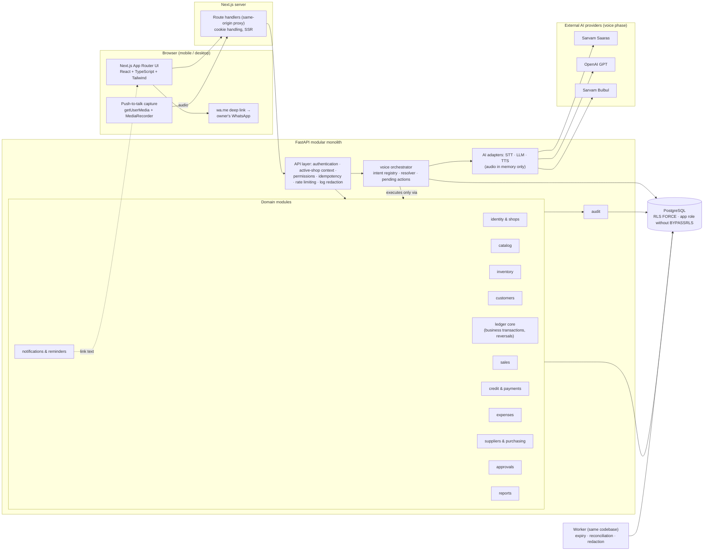
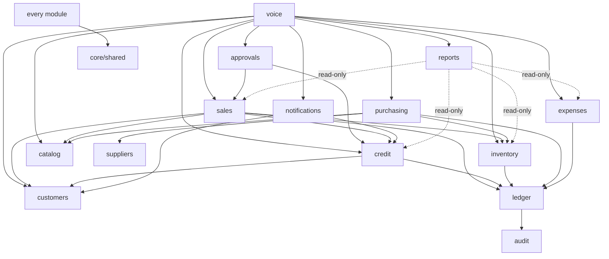
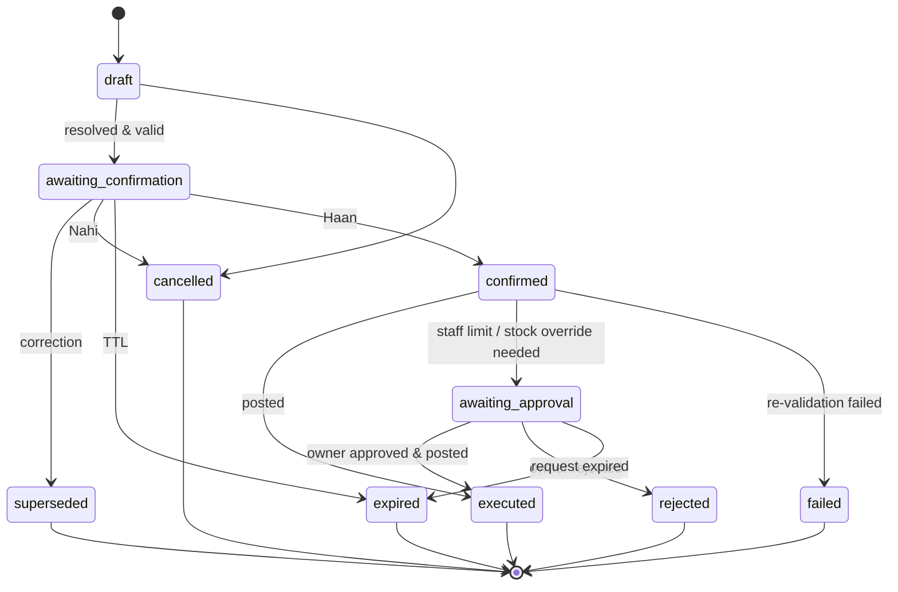
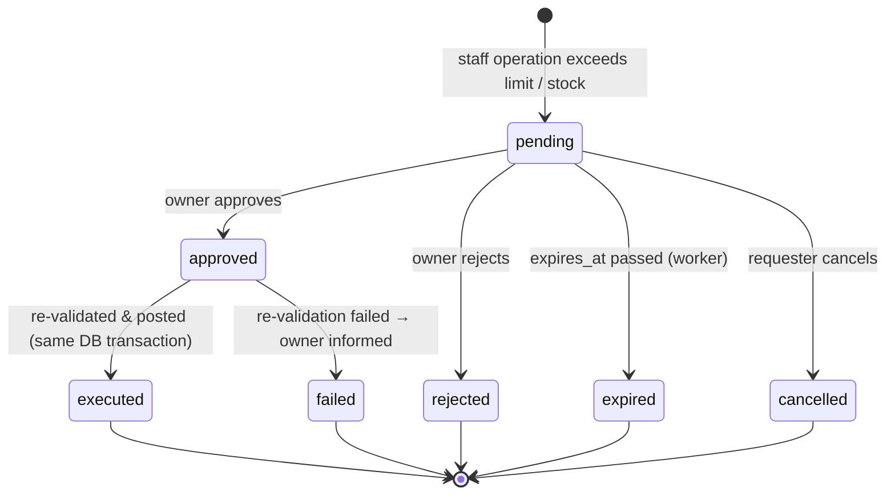
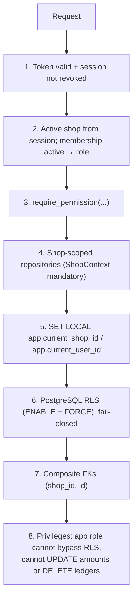

# Munim AI — System Architecture

| Field | Value |
|---|---|
| Version | 0.2 (Phase 1 — revised after stakeholder review) |
| Date | 2026-11-18 |
| Related | [SRS.md](SRS.md), [database-design.md](database-design.md), [risk-analysis.md](risk-analysis.md) |

### Changes since v0.1

| Area | Change | Section |
|---|---|---|
| Authentication | Phone + password (Argon2id), lockout, sessions; OTP removed from MVP | §6 |
| Multi-shop | Active shop on the session; switching endpoint designed | §6.4 |
| Voice audio | Object storage removed; audio stays in memory only | §2, §7.5 |
| Approvals | New approval workflow and module | §8.3 |
| Ledger core | `business_transactions` and a `ledger` module | §3, §8.4 |
| Reminders | WhatsApp deep links only; no messaging provider | §4.5 |
| Security | Explicit security verification matrix | §9 |
| ADRs | ADR-13 to ADR-18 added; ADR-10 unchanged | §11 |

---

## 1. Architectural goals and drivers

| Driver | Consequence |
|---|---|
| Money correctness | Deterministic domain services, append-only ledgers, integer paise, one DB transaction per business operation |
| LLMs are probabilistic | The LLM is an untrusted parser that proposes; the backend validates, resolves, computes; a human confirms |
| Small team, 5–10 shop pilot | Modular monolith; one backend deployable + one worker; no microservices |
| Multi-tenant SaaS, multi-shop owners | `shop_id` everywhere; app-layer scoping + PostgreSQL RLS; active shop bound to the session |
| Voice and manual parity | Both call the same domain services |
| Unreliable networks | Idempotency keys on every write |
| Privacy | No raw audio retention; PII-free logs; minimal data to AI providers |
| Replaceable AI vendors | STT/LLM/TTS behind adapters |

## 2. High-level architecture



**Key point:** voice changes data only by calling domain services, the same path as a button press. The LLM sits behind the adapters with no route to PostgreSQL. There is no object storage, because audio is never persisted. There is no messaging provider: the browser opens WhatsApp and the owner sends the message.

## 3. Repository and module layout

```
munim-ai/
├── frontend/    # Next.js app
├── backend/     # FastAPI modular monolith + worker entrypoint
├── docs/
├── infra/       # local PostgreSQL setup scripts; optional Docker files; deployment (later)
└── README.md
```

```
backend/app/
├── main.py                  # API app factory
├── worker.py                # background worker entrypoint
├── core/                    # settings, db (session, SET LOCAL shop context), security
│                            # (argon2, tokens), idempotency, rate limit, errors,
│                            # logging + redaction, request context
├── shared/                  # money (paise), quantity/units, time/business date
└── modules/
    ├── identity/            # users, passwords, sessions, login attempts
    ├── shops/               # shops, members, settings, active-shop switching
    ├── catalog/
    ├── inventory/           # levels, movements, counts, avg cost
    ├── customers/
    ├── ledger/              # business_transactions, reversal orchestration
    ├── sales/
    ├── credit/              # credit entries, payments, allocations
    ├── approvals/
    ├── expenses/
    ├── suppliers/
    ├── purchasing/
    ├── reports/
    ├── notifications/       # in-app notifications, reminder links
    ├── voice/
    ├── ai/                  # adapter interfaces + fake + provider impls
    └── audit/
```

Each module contains `api.py` (HTTP only), `schemas.py` (Pydantic), `service.py` (public interface and domain logic), `models.py` and `repository.py` (private, always shop-scoped).

**Boundary rules:** modules call each other only through `service.py`; no cycles (`import-linter` in CI); the orchestrating service owns the transaction and passes one unit of work to the services it calls; `reports` reads through dedicated read-only queries.



## 4. Responsibilities

### 4.1 Frontend (Next.js)

| Responsibility | Notes |
|---|---|
| Responsive, mobile-first UI | Dashboard (business summary), sales, products, customers/udhaar, approvals inbox (owners), expenses, suppliers/POs, reports, settings |
| Voice capture | `MediaRecorder` (Opus/WebM, MP4/AAC fallback), push-to-talk, ≤ 15 s, mono; audio is sent once and not kept client-side after upload |
| Confirmation and approval UX | Cards rendered from backend data; Haan / Nahi / Badlo; override-reason picker; "sent to owner for approval" state |
| Reminder links | Renders a backend-generated message + phone as a `wa.me` link the owner taps |
| Idempotency | One UUID per user intent, reused on retry |
| Localization | Hindi / Hinglish / English; `en-IN` number formatting; metric labels exactly as defined (no "kamai") |
| Never does | Persisted money calculations, permission decisions, AI provider calls, holding secrets |

**Decision (was open in v0.1):** the browser calls the API **through Next.js route handlers on the same origin**. Tokens stay in httpOnly cookies, CORS is not needed, and the cookie policy stays simple. FastAPI also validates tokens itself, so the proxy is never a trust boundary.

*Implementation note (Phase 2.1):* the same-origin proxy is currently a `next.config.ts` rewrite of `/api/v1/*` to FastAPI (the Next.js-documented mechanism for forwarding to a separate backend). Route Handlers will be added where requests need transformation, such as auth cookie handling in Phase 2.2. The principle (same origin, no CORS, no backend URL in the browser) is unchanged.

### 4.2 Backend (FastAPI)

Authentication, sessions and rate limiting; active-shop context; permissions; all business logic and calculations; transaction boundaries; idempotency; voice orchestration; approvals; audit; log redaction; OpenAPI.

**Worker:** a separate process from the same codebase that polls a PostgreSQL `jobs` table (`FOR UPDATE SKIP LOCKED`). Jobs: expire pending actions and approval requests, nightly ledger reconciliation, transcript redaction, session/login-attempt cleanup. No Redis/Celery for the pilot (ADR-10).

### 4.3 Database (PostgreSQL)

System of record; constraints (FKs, composite tenant FKs, CHECKs such as `total = paid_now + credit`); atomic multi-table transactions; row locks; RLS with `FORCE`; append-only enforcement through privileges; `pg_trgm` for fuzzy name matching. Details: [database-design.md §8–9](database-design.md).

### 4.4 AI services (voice phase)

| Component | Responsibility | Must not |
|---|---|---|
| STT (Saaras) | Audio → transcript, language, confidence | Retain audio (provider settings/terms verified before go-live) |
| LLM (GPT, tool calling) | Transcript + minimal context → one tool call with *text* arguments | Write data, compute totals, pick IDs, see phone numbers/ledgers/other shops, author numbers shown to users |
| TTS (Bulbul) | Backend template text → audio | — |

Adapters (`SpeechToText`, `IntentParser`, `TextToSpeech` protocols) have **fake implementations** for tests and local development, so no paid keys are needed before the voice phase.

### 4.5 Reminders (MVP)

The backend selects eligible customers deterministically (consent, valid phone, frequency cap) and returns the message text. The frontend builds `https://wa.me/<phone>?text=<urlencoded message>` when rendering. The owner taps it, WhatsApp opens, and the owner presses send. The backend records `generated` and `opened`, plus `marked_sent` if the owner marks it. The URL is never stored or logged.

## 5. API communication

- REST/JSON over HTTPS under `/api/v1`; OpenAPI → generated TypeScript client.
- **The shop is never in the URL or body.** It comes from the session's active shop (ADR-07).
- **Writes require `Idempotency-Key`**; same key + same fingerprint → stored response; same key + different body → `409`; concurrent duplicate → `409 IN_PROGRESS` (retry later).
- Error envelope `{error: {code, message, message_hi, details}}`; login errors are generic.
- Money as integer paise; quantities as decimal strings.
- Cursor pagination; `X-Request-ID` correlation; optimistic concurrency (`version`) on master data.
- Representative endpoints: `POST /auth/register`, `POST /auth/login`, `POST /auth/refresh`, `POST /auth/logout`, `POST /auth/password`, `GET /me/shops`, `POST /session/active-shop`, `POST /sales`, `POST /sales/{id}/reverse`, `POST /payments` (with optional allocations), `GET /customers/{id}/open-entries`, `POST /approvals/{id}/approve`, `POST /voice/commands`, `POST /pending-actions/{id}/confirm`, `GET /reports/summary?from=&to=`, `POST /reminders/links`.

## 6. Authentication and session management

### 6.1 Registration and login

```mermaid
sequenceDiagram
    participant B as Browser
    participant N as Next.js route handler
    participant A as FastAPI identity
    participant DB as PostgreSQL
    B->>N: POST /auth/login {phone, password}
    N->>A: forward
    A->>A: rate limit (phone HMAC + IP)
    A->>DB: load user by phone; check locked_until
    A->>A: Argon2id verify (constant-time; dummy hash if user missing)
    alt failure
        A->>DB: login_attempts++, failed_login_count++, maybe lock
        A-->>B: 401 generic "phone ya password galat"
    else success
        A->>A: rehash if parameters outdated
        A->>DB: reset counters; revoke any presented session; create auth_session (active_shop_id = last active); audit
        A-->>N: new random session token (only its SHA-256 is stored)
        N-->>B: Set-Cookie munim_session: HttpOnly, Secure, SameSite=Strict
    end
```

### 6.2 Password handling

| Aspect | Design |
|---|---|
| Algorithm | **Argon2id** (`argon2-cffi` in Phase 2) |
| Parameters | `argon2-cffi` defaults = RFC 9106 low-memory profile (t = 3, m = 64 MiB, p = 4), above the OWASP baseline; stored in the encoded hash |
| Upgrade | `needs_rehash` checked on successful login |
| Policy | 8–128 chars; common-password blocklist; no composition rules; Unicode normalized (NFKC) |
| Enumeration | Identical response and similar timing for unknown phone vs wrong password (verify against a dummy hash) |
| Lockout | Per account: locked for `LOGIN_LOCKOUT_MINUTES` (15) after `LOGIN_MAX_FAILURES` (5) consecutive failures; per client IP: `LOGIN_IP_MAX_ATTEMPTS` (30) failures per 10 minutes (DB-backed `login_attempts`, HMAC-hashed). Registration: per-IP hourly limit (in-process). Locked and throttled responses are identical (429) |
| Staff accounts | Created by owner with a temporary password; `must_change_password` forces a change at first login |
| Change | Requires current password; revokes **all** sessions and issues a fresh one to the caller; audited |
| Recovery | Self-service deferred until OTP; interim process is open question Q-18 |
| Never | Log, return, or store plaintext passwords; include passwords in error reports |

### 6.3 Server-side sessions (implemented in Phase 2; supersedes the JWT draft, see ADR-19)

- **Session token:** a 256-bit random value (`secrets.token_urlsafe(32)`) in the cookie `munim_session` (`HttpOnly; Secure; SameSite=Strict; Path=/`). Only `SHA-256(token)` is stored in `auth_sessions.token_hash`, so a database leak doesn't reveal usable tokens.
- **Validation on every request:** look up the hash; reject if revoked, past `expires_at` (absolute, 30 days) or idle longer than 7 days (`last_seen_at`, refreshed at most every 5 minutes); the user must be active. Revocation therefore takes effect on the next request.
- **Fixation:** a new token is issued on every login and password change; a session cookie presented with a login request is revoked; client-chosen tokens are never accepted.
- **CSRF:** SameSite=Strict + Origin allow-list (`FRONTEND_ORIGINS`) on state-changing requests.
- **Membership:** role and active-shop membership are loaded from the database on every request (`get_shop_context`), so removing a member takes effect immediately.
- Device list, revoke one, log out everywhere.

### 6.4 Multiple shops and the active shop

- An owner may hold owner memberships in many shops.
- `auth_sessions.active_shop_id` is the **only** source of shop context. At login it defaults to `users.last_active_shop_id`, or the user's single shop.
- `GET /shops/mine` lists memberships, readable through the `shop_members` self policy.
- `POST /session/active-shop {shop_id}`: verifies the active membership → updates `auth_sessions.active_shop_id` → audit. A non-member gets 404, the same as a non-existent shop. Implemented with a switcher UI in Phase 2.
- A user with no shop yet gets a session without a shop and can only call onboarding endpoints.

## 7. Voice-processing workflow

### 7.1 Sequence

```mermaid
sequenceDiagram
    autonumber
    participant U as User
    participant FE as Browser
    participant API as FastAPI voice
    participant STT as STT adapter
    participant LLM as LLM adapter
    participant SVC as Resolver + domain services
    participant DB as PostgreSQL
    participant TTS as TTS adapter

    U->>FE: Hold mic, "Ramesh ko 1500 ka udhaar" (staff)
    FE->>API: POST /voice/commands (audio ≤ 1 MB, Idempotency-Key)
    API->>STT: transcribe(bytes in memory)
    STT-->>API: transcript, confidence
    API->>API: drop audio buffer
    API->>LLM: transcript + tool schemas + minimal context
    LLM-->>API: give_credit{customer_text:"Ramesh", amount:1500}
    API->>API: Pydantic validation + number cross-check vs transcript
    API->>SVC: resolve customer, permission, limits
    SVC->>DB: shop-scoped search (RLS)
    SVC-->>API: Ramesh (doodh wale), balance ₹1,200; exceeds staff limit ₹1,000
    API->>DB: voice_command + pending_action (awaiting_confirmation)
    API->>TTS: template text
    API-->>FE: card "₹1,200 → ₹2,700. Limit se zyada — owner approval lagega. Bhejein?"
    U->>FE: Haan
    FE->>API: POST /pending-actions/{id}/confirm
    API->>DB: BEGIN; approval_request(pending); pending_action→awaiting_approval; notification; audit; COMMIT
    API-->>FE: "Owner ko bhej diya"
```

For a normal confirmation (within limits), step 15 instead posts the business transaction atomically (§8.2).

### 7.2 Session context
A voice session allows one active pending action. The LLM sees only the last few turns, the current pending summary and candidate display names. "Haan/nahi/theek hai/cancel" are matched deterministically before falling back to the LLM.

### 7.3 Deterministic entity resolution
Products and customers: exact alias → transliteration-normalized → trigram → phonetic; never auto-select close customer candidates. Units and Hindi number words ("dhai sau", "sava", "paav") come from lookup tables. Dates are resolved in the shop timezone. The LLM's numbers are cross-checked against the transcript.

### 7.4 Intent registry
Each intent is defined once: tool schema, kind (read/write), risk, permission, resolver, confirmation template, executor (the same service function the manual UI uses), and an escalation rule (e.g. `give_credit` checks the staff limit and routes to approvals).

### 7.5 Audio handling (no retention)

| Step | Rule |
|---|---|
| Upload | Max size about 1 MB / 15 s; the endpoint reads the body into memory with a hard cap **below the framework's spool-to-disk threshold**, so no temp file is ever created |
| Processing | Bytes are passed straight to the STT adapter; the buffer is released right after the call (success or failure) |
| Persistence | Never written to disk, object storage, database, cache, logs or error reports; `voice_commands` stores duration and MIME type only |
| Provider | STT provider configured for no retention / no training where offered; terms reviewed before the voice phase |
| Transcript | Stored for audit for a limited period (Q-16), then redacted by a worker job; structured intent/outcome kept |
| Browser | The recording blob is released after upload; not kept in IndexedDB |

## 8. Transaction, confirmation and approval workflows

### 8.1 Pending action state machine



### 8.2 Confirmation rules
1. The pending action stores the fully resolved payload, a payload hash and the exact summary shown.
2. On confirm, inside the posting transaction: **re-validate** (price, stock, permissions, archived entities). If the result differs from what was shown, nothing is posted and a fresh confirmation is returned.
3. Single execution: `UPDATE … SET status='confirmed' WHERE id=:id AND status='awaiting_confirmation' AND expires_at > now()` must affect exactly one row.
4. The posted business transaction stores `pending_action_id` and `source='voice'`.
5. Manual UI writes skip pending actions (the form is the confirmation) but use the same services, checks, idempotency and approval escalation.

### 8.3 Owner approval workflow



- **Triggers (MVP):** staff udhaar above `shop_members.credit_limit_paise`; staff itemized sale above available stock (stock override).
- **Who decides:** any active owner of that shop except the requester.
- **Approval transaction:** lock the request (status = pending, not expired) → re-validate the payload against current data → if the outcome is unchanged, post the business transaction with `initiated_by = staff`, `approved_by = owner`, `approval_request_id` → update the request and pending action → notify the requester → audit. Approval and posting happen together or not at all.
- **Owner's own operations** never need approval; an owner's stock override records the reason directly on the transaction.

### 8.4 Business transactions and reversals
Every money/stock operation is posted through the **ledger** module, which creates the `business_transactions` header and lets the specific service write its child rows in the same unit of work. Reversal (`POST /…/{id}/reverse`):
1. Lock the original header (`status = posted`, not a reversal).
2. Create the reversal header (`reverses_transaction_id`, a unique constraint guarantees at most one).
3. Each owning module writes exact negations: stock movements, credit entries, allocation reversals with FIFO reallocation of freed payments, and an optional refund payment.
4. Mark the original `reversed`; update caches; audit; commit.

### 8.5 Idempotency implementation
At request start, insert `(shop, user, key, fingerprint, in_progress)`. A unique violation means a duplicate: return the stored response if completed, `409 IN_PROGRESS` if still running, `409` if the fingerprint differs. The business writes and the `completed` update (with the response body) commit **in the same DB transaction**, so a crash leaves either both or neither. Keys expire after 48 h.

## 9. Data security and shop-level isolation

### 9.1 Defence layers



### 9.2 Security verification matrix

> **Phase 2 status:** SV-1 to SV-8 and SV-10 are implemented and verified by automated tests on PostgreSQL 18; SV-9 (audio) applies in Phase 5. Current evidence per control: [security-checklist.md](security-checklist.md).

Status today is *design-verified*. Each control has a concrete automated check that is built in Phase 2 and must pass in CI before the control counts as implemented.

| # | Requirement | Design control | Verification (Phase 2 test / check) |
|---|---|---|---|
| SV-1 | PostgreSQL RLS is enforced | Every tenant table: `ENABLE` + `FORCE ROW LEVEL SECURITY`; policy on `app.current_shop_id`; missing setting → no rows | Migration test lists all tables with `shop_id` and asserts `relrowsecurity` and `relforcerowsecurity` are true and a policy exists; query without context returns 0 rows |
| SV-2 | App role cannot bypass RLS | `munim_app` is `NOSUPERUSER NOBYPASSRLS`, not table owner; migrations use `munim_owner` | Startup self-check queries `pg_roles` for the current role and refuses to start if `rolbypassrls` or `rolsuper` is true or it owns tenant tables; CI test does the same |
| SV-3 | Shop context comes from authenticated server-side identity | Active shop read from `auth_sessions` via validated token; no `shop_id` accepted in paths/bodies; `SET LOCAL` per transaction | Tests: request bodies containing `shop_id` are rejected (`extra="forbid"`); switching requires active membership; revoked membership → 403 on the next request |
| SV-4 | Cross-shop access is prevented | Layers 4–7 above; 404 for foreign IDs | **Tenant isolation suite:** two shops with data; every endpoint attempts read/write of the other shop's IDs → 404/no effect; direct SQL under shop A's context cannot see shop B rows; composite FK rejects a cross-shop insert |
| SV-5 | Financial records are auditable | Business transaction header for every operation; append-only tables (privileges + triggers); audit log in the same transaction; linked reversals | Tests: UPDATE of amount / DELETE as `munim_app` fails; every posting writes a header + audit row; reversal links both ways; invariant/reconciliation tests (database-design §7) |
| SV-6 | Duplicate requests are idempotent | `Idempotency-Key` required; unique key table committed with the business writes; single-execution pending actions/approvals | Tests: same request twice → one transaction, identical response; concurrent duplicates → one success + one 409; double confirm → one execution; missing key on write → 400 |
| SV-7 | Passwords securely hashed | Argon2id with tuned parameters, rehash, dummy-hash timing equalization, lockout | Tests: stored hash starts with `$argon2id$`; plaintext never persisted (DB scan in test); lockout triggers; timing of unknown vs wrong password within tolerance |
| SV-8 | Sensitive data excluded from logs | Structured logger with field **allowlist** + redaction processor (phone, name, password, token, transcript, `wa.me`, Authorization, Cookie); request/response bodies never logged for auth/financial/voice routes; error tracker with PII scrubbing | Test captures logs while running auth, sale, voice and reminder flows with sentinel values (e.g. phone `+919999900000`, name `ZZTESTNAME`) and asserts none appear; lint rule against logging request objects |
| SV-9 | Raw audio not retained | In-memory processing, capped below spool threshold, no audio columns | Test: voice endpoint leaves no new files in temp dirs and no audio bytes in DB; schema test asserts no bytea/audio columns in voice tables |
| SV-10 | Secrets not in Git | env / secret manager; `.env` ignored; gitleaks pre-commit + CI | CI secret scan; settings fail fast if required secrets are missing; `.env.example` contains placeholders only |

### 9.3 Other measures
TLS 1.2+ / HSTS; DB TLS in production; encrypted disks and backups; optional column encryption for customer phone numbers (decided in the schema task); dependency scanning (`pip-audit`, `npm audit`, Dependabot); platform-admin access to shop data only via audited, time-boxed grants (future).

## 10. Deployment view

Local (Phase 2): **native PostgreSQL on Windows** (decision of 2026-11-18: no Docker for local development). The `munim_ai` database and the two roles are created by `infra/postgres/local-setup.sql`. Backend and frontend run natively; AI adapters are fakes. The Docker Compose files are kept as an optional, currently unused alternative.

Production (later): Next.js container, FastAPI containers ×N, worker container, managed PostgreSQL with PITR in an Indian region. **Provider selection is open (Q-13).** Criteria: India region availability and data residency, managed PostgreSQL with PITR and encrypted backups, private networking, secret manager, cost at pilot scale, and backup/restore testing support.

## 11. Architecture decisions (ADR summary)

| # | Decision | Rationale |
|---|---|---|
| ADR-01 | Modular monolith + worker | Team size; transactional consistency |
| ADR-02 | LLM proposes, backend disposes | Correctness, auditability, injection safety |
| ADR-03 | Server-side pending actions | Idempotent execution, audit trail |
| ADR-04 | Money as BIGINT paise | Exact; JS-safe |
| ADR-05 | Append-only ledgers + transactional caches | Auditability with fast reads |
| ADR-06 | Shared schema + `shop_id` + RLS | Many small tenants; defence in depth |
| ADR-07 | Shop context from session, never URL/body | Removes IDOR class |
| ADR-08 | Idempotency-Key on writes, committed with the business writes | No duplicates under retries/crashes |
| ADR-09 | AI provider adapters | Swappable, testable, cost control |
| ADR-10 | PostgreSQL job queue | One fewer component for the pilot |
| ADR-11 | Deterministic entity resolution | No hallucinated IDs |
| ADR-12 | UUID v7 keys | Non-enumerable, index-friendly |
| **ADR-13** | **`business_transactions` header for all money/stock operations** | Linked reversals, approvals, overrides and audit in one place; future double-entry export |
| **ADR-14** | **Separate revenue (`sales`) from cash collection (`payments`); allocations for udhaar** | Partial payments, old-dues settlement, honest metrics |
| **ADR-15** | **Approval requests as first-class records** | Staff limits and stock overrides with full traceability |
| **ADR-16** | **Phone + password (Argon2id) for MVP; OTP later** | No SMS/DLT dependency for the pilot; strong hashing and lockout |
| **ADR-17** | **Same-origin Next.js proxy for API calls** | httpOnly cookies, no CORS, simple CSRF story |
| **ADR-18** | **No raw audio persistence anywhere** | Privacy, DPDP posture, less breach surface |
| **ADR-19** | **Opaque server-side sessions (hashed tokens) instead of JWT access/refresh tokens** (Phase 2) | Immediate revocation, no token-signing keys to manage, fewer dependencies; one indexed lookup per request is cheap at pilot scale |
| **ADR-20** | **Roles owner / admin / staff**; admin = shop details + staff management only (Phase 2, to be confirmed: Q-23) | The Phase 2 brief requested an admin role; kept conservative so no privilege escalation is possible |
| **ADR-21** | **Tenant context via transaction-local settings applied in a SQLAlchemy `after_begin` hook** | Context can't leak through the pool and is re-applied after every commit; missing context fails closed |

## 12. Items settled during Phase 2

See [phase-2-implementation.md](phase-2-implementation.md) for what was built, verified and deferred.

### Original list

1. Column-level encryption for customer phone numbers (schema task).
2. Exact Argon2id parameters after benchmarking on target hardware.
3. Rate-limit storage: PostgreSQL table vs in-process (single instance in the pilot) — start with PostgreSQL.
