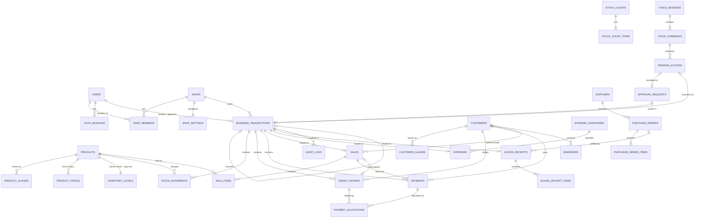

# Munim AI — Database Design (Conceptual / Logical)

| Field | Value |
|---|---|
| Version | 0.2 (Phase 1 — revised after stakeholder review) |
| Date | 2026-11-18 |
| Scope | Entities, purposes, key attributes, relationships, constraints and transaction boundaries. **Not** the final physical schema — exact column types, indexes, RLS SQL and migrations are a separate Phase 2 task |
| Related | [SRS.md](SRS.md), [architecture.md](architecture.md), [risk-analysis.md](risk-analysis.md) |

---

## 0. Changes since v0.1

The v0.1 model was reviewed against the finalized product decisions and the eight scenarios in §6. Significant changes, each explained in §5:

| # | Change | Type | Why |
|---|---|---|---|
| C1 | New **`business_transactions`** header table; every financial/stock row belongs to one | Added | Uniform linked reversals, one place for actor/approver/override/source, complete audit history |
| C2 | **`sale_payments` removed**; **`payments`** now records *every* money movement (at sale, credit collection, refund) with `direction` and `purpose` | Replaced | Separates revenue (sales) from cash collection (payments) cleanly; one table answers "cash collected" |
| C3 | New **`payment_allocations`** table; `credit_entries` gain `settled_paise` | Added | Partial payments and settling specific previous dues; udhaar ageing |
| C4 | `sales` gain `paid_now_paise`, `credit_paise`, `sale_type` (itemized / unitemized), `status` (active / reversed) | Changed | Cash + credit split on one sale; unitemized sales without stock deduction |
| C5 | `sale_items` gain `unit_cost_paise` snapshot + `cost_known`; `inventory_levels` gain `avg_cost_paise` | Changed | Gross profit and estimated net profit |
| C6 | New **`approval_requests`** table; `pending_actions` gain state `awaiting_approval` | Added | Owner approval of staff credit over limit; owner stock overrides by staff request |
| C7 | Stock-override fields on `business_transactions` | Added | Block insufficient-stock sales by default; owner override with recorded reason |
| C8 | New `stock_counts` / `stock_count_items` | Added | Physical stock correction with full history |
| C9 | `users` gain `password_hash` (Argon2id) and lockout fields; new `login_attempts`; **`otp_challenges` removed** (deferred) | Changed | Phone + password login decision |
| C10 | `users.last_active_shop_id`, `auth_sessions.active_shop_id` | Added | Multi-shop ownership with one active shop and future switching |
| C11 | `voice_commands.audio_ref` **removed**; transcript retention/redaction fields added | Changed | Raw audio is never stored |
| C12 | `reminders` simplified to WhatsApp-link generation only | Changed | No WhatsApp Business API |
| C13 | New `customer_aliases` (was "array or table"), `credit_entries` type `opening_balance` | Clarified / added | Duplicate names; migrating existing notebook balances |
| C14 | Database-role and RLS rules made explicit (§8) | Clarified | Security review |

Considered and **not** adopted: full double-entry bookkeeping (chart of accounts, journal lines). It would be the right model once GST/accounting exports arrive, but it is heavier than a kirana MVP needs. `business_transactions` is designed so a future journal can be derived from it (§5.1).

---

## 0.1 Phase 2 implementation clarifications

The physical schema ([physical-schema.md](physical-schema.md)) implements this design. Where the implementation had to be more specific:

| Topic | Clarification |
|---|---|
| `auth_sessions` | Holds a SHA-256 hash of an opaque **session token** (`token_hash`) instead of `refresh_token_hash` / `token_family_id`: server-side sessions replaced the JWT access/refresh draft (architecture ADR-19) |
| `shop_members.role` | `owner`, `admin`, `staff` (admin added in Phase 2, architecture ADR-20; viewer remains future) |
| `idempotency_keys.shop_id` | Nullable: requests made before a shop exists (creating the first shop) are scoped to the user only. Two partial unique indexes |
| `audit_logs.created_at` | Python-side default, so shop-less rows (write-only under RLS) can be inserted without `RETURNING` |
| Enum strategy | `text` + named CHECK constraints (no PostgreSQL ENUM types) |
| RLS context | `app_current_shop_id()` / `app_current_user_id()` functions over transaction-local settings, `NULLIF(..., '')` so empty means no access |
| Circular FKs | `business_transactions ↔ approval_requests ↔ pending_actions`, `voice_sessions → pending_actions`, `users → shops` are created after all tables |
| Document numbers | `sales.sale_number` and `purchase_orders.po_number` are `bigint`, unique per shop; the allocation mechanism is designed in Phase 3 (Q-24) |
| `product_prices` (Phase 3) | Also records each product's **initial** selling price (and cost price, if given) at creation, not only later changes. Later rows are appended only when a value actually changes; prices change only through the dedicated price endpoint |
| `product_aliases.normalized_text` (Phase 3) | Produced by `app/shared/text.py`: NFKC, case-fold, symbols/punctuation → spaces, Indic vowel signs kept, Indic digits → ASCII. No transliteration; `phonetic_key` stays NULL until the voice phase. Aliases are unique per product (two products may share an alias) |
| Product barcodes (Phase 3) | The unique index covers archived products too, so an archived product's barcode stays reserved (approved rule); the API returns 409 `BARCODE_RESERVED_BY_ARCHIVED` |
| Categories (Phase 3) | `product_categories` has no `version` column: category edits are last-write-wins. A category can't be archived while active products use it |

## 1. Design principles

| # | Principle | Detail |
|---|---|---|
| P1 | **Tenant-owned rows** | Every business table has `shop_id NOT NULL`. Only identity/platform tables (`users`, `auth_sessions`, `login_attempts`, `units`, `jobs`) are global |
| P2 | **Composite tenant keys** | Child tables reference parents with `(shop_id, parent_id)` → `(shop_id, id)` so cross-shop links are impossible |
| P3 | **UUID v7 primary keys** | Non-guessable, time-ordered |
| P4 | **Money = BIGINT paise** | Column names end in `_paise`. CHECK constraints for sign. No floats, anywhere |
| P5 | **Quantity = NUMERIC(14,3)** in the product's base unit | The spoken/entered unit is kept for display and audit |
| P6 | **Append-only ledgers** | `business_transactions`, `stock_movements`, `credit_entries`, `payments`, `payment_allocations`, `audit_logs` are insert-only. Corrections are reversal rows in a reversal transaction |
| P7 | **Status, not delete** | Only status/link columns may be updated on financial rows (enforced by column-level grants, §8.3). Master data uses `archived_at` |
| P8 | **Cached aggregates** | `inventory_levels.quantity_on_hand`, `inventory_levels.avg_cost_paise`, `customers.balance_paise`, `credit_entries.settled_paise`, `payments.unallocated_paise` are caches updated in the same transaction and recomputable from ledgers |
| P9 | **Two times** | `business_date` / `occurred_at` (when it happened, shop timezone) vs `created_at` (when recorded) |
| P10 | **Traceability** | Every business transaction records initiator, approver, source (`manual`/`voice`/`system`), `pending_action_id`, `approval_request_id`, idempotency key |
| P11 | **Atomicity** | All rows of one business transaction are committed in one PostgreSQL transaction together with cache updates, audit log and idempotency record |

## 2. Entity overview (v0.2)

| Module | Entities |
|---|---|
| identity | `users`, `auth_sessions`, `login_attempts` |
| shops | `shops`, `shop_members`, `shop_settings` |
| catalog | `units`, `product_categories`, `products`, `product_aliases`, `product_prices` |
| inventory | `inventory_levels`, `stock_movements`, `stock_counts`, `stock_count_items` |
| customers | `customers`, `customer_aliases` |
| ledger core | **`business_transactions`** |
| sales | `sales`, `sale_items` |
| credit & payments | `credit_entries`, `payments`, **`payment_allocations`** |
| approvals | **`approval_requests`** |
| expenses | `expense_categories`, `expenses` |
| suppliers | `suppliers`, `supplier_products` |
| purchasing | `purchase_orders`, `purchase_order_items`, `goods_receipts`, `goods_receipt_items` |
| voice | `voice_sessions`, `voice_commands`, `pending_actions` |
| notifications | `reminders`, `notifications` |
| audit | `audit_logs` |
| core | `idempotency_keys`, `jobs` |

## 3. Entity–relationship diagram (logical)

(Every business entity also carries `shop_id`; only the most important links are drawn.)

## 4. Entity catalogue

Key attributes are indicative; final names/types come in the schema task.

### 4.1 Identity and shops

#### `users` *(changed — C9, C10)*
- **Purpose:** A person who can log in. Global, because one person may belong to several shops.
- **Key attributes:** id, phone (E.164, unique), name, preferred_language, **password_hash** (Argon2id encoded string incl. parameters and salt), **password_changed_at**, **must_change_password** (for owner-created staff accounts), **failed_login_count**, **locked_until**, **last_active_shop_id** (nullable), status (active/disabled), last_login_at.
- **Notes:** Phone is not yet verified by OTP (deferred); see risk R-13. `phone_verified_at` is reserved for the later OTP phase.

#### `auth_sessions` *(changed — C10)*
- **Purpose:** One row per logged-in device; holds the hashed rotating refresh token.
- **Key attributes:** id, user_id, refresh_token_hash, token_family_id, **active_shop_id**, device_label, user_agent, ip_hash, created_at, last_used_at, expires_at, revoked_at, revoke_reason.
- **Rules:** Password change or staff deactivation revokes all sessions. Refresh-token reuse revokes the whole family.

#### `login_attempts` *(added — C9)*
- **Purpose:** Records login attempts for rate limiting, progressive lockout and security audit.
- **Key attributes:** id, phone_hash (HMAC, not raw phone), ip_hash, succeeded, failure_reason (bad_credentials/locked/disabled), attempted_at.
- **Retention:** 30 days, then purged.

#### `shops`
- **Purpose:** The tenant; root of all business data.
- **Key attributes:** id, name, business_type, address, city, state, pincode, timezone, default_language, status (active/suspended), created_by_user_id.

#### `shop_members` *(clarified — multi-shop, approvals)*
- **Purpose:** A user's membership and role in a shop. **One owner can own many shops** through many owner memberships.
- **Key attributes:** shop_id, user_id, role (owner/staff), **credit_limit_paise** (per-transaction udhaar limit for staff; null = no udhaar permission override), permission overrides (validated JSONB), status (active/removed), invited_by_user_id, joined_at, removed_at.
- **Constraints:** unique (shop_id, user_id); at least one active owner per shop (service-enforced + test).

#### `shop_settings`
- **Purpose:** Per-shop configuration: voice confirmation thresholds, default staff credit limit, approval-request expiry, low-stock defaults, reply language, reminder message template, reminder frequency cap.

### 4.2 Catalog

#### `units` (global reference)
- Canonical units, dimension, conversion factor, `allows_decimal`, display names and spoken forms ("kilo", "किलो", "paav" = 0.25 kg).

#### `product_categories`
- Shop-owned grouping (Staples, Dairy…), seeded from templates.

#### `products` *(clarified — C5)*
- **Purpose:** An item the shop sells or buys.
- **Key attributes:** id, shop_id, name, name_hi, category_id, base_unit_code, is_loose, **selling_price_paise** (current, per base unit), **default_cost_price_paise** (nullable; used only until the first purchase receipt establishes an average cost), reorder_level, barcode, archived_at, version.
- **Notes:** The *current* average cost lives in `inventory_levels.avg_cost_paise` (hot, locked with stock). Price history in `product_prices`.

#### `product_aliases`
- Alternate names in any script/language for voice resolution ("chini", "cheeni", "शक्कर"). Attributes: alias_text, normalized_text, phonetic_key, language, source (seed/manual/learned).

#### `product_prices`
- History of selling-price and manual cost-price changes: price_type, price_paise, effective_from, set_by_user_id.

### 4.3 Inventory

#### `inventory_levels` *(changed — C5)*
- **Purpose:** Cached current stock and current weighted-average cost per product.
- **Key attributes:** shop_id, product_id (PK pair), quantity_on_hand (NUMERIC; may be negative **only** as the result of a recorded override), **avg_cost_paise** (nullable = cost unknown), last_movement_id, updated_at.
- **Rules:** Updated only by the inventory service inside the business transaction after `SELECT … FOR UPDATE`. Average cost recalculated on each purchase receipt: `new_avg = round_half_up((on_hand × avg + received_qty × unit_cost) / (on_hand + received_qty))`, using on_hand floored at 0 when negative. Nightly reconciliation checks `quantity_on_hand = Σ stock_movements.quantity_delta`.

#### `stock_movements` *(changed — C1)*
- **Purpose:** Immutable ledger of every stock change; the source of truth for stock.
- **Key attributes:** id, shop_id, **transaction_id**, product_id, movement_type (opening, sale, sale_reversal, purchase_receipt, purchase_reversal, adjustment_damage, adjustment_expiry, adjustment_loss, adjustment_count, return_to_supplier), quantity_delta (signed, ≠ 0), unit_cost_paise (cost at the time — for sales, the avg cost snapshot), reference_type + reference_id (sale_item / goods_receipt_item / stock_count_item), reverses_movement_id, quantity_on_hand_after (snapshot), occurred_at.

#### `stock_counts` / `stock_count_items` *(added — C8)*
- **Purpose:** A physical stock count session (whole shop or selected products). Each item records `system_quantity` at count time, `counted_quantity`, and `difference`; posting the count creates one `stock_adjustment` business transaction with `adjustment_count` movements for non-zero differences.
- **Key attributes (header):** id, shop_id, status (draft/posted/cancelled), started_by_user_id, posted_transaction_id, notes. **(item):** stock_count_id, product_id, system_quantity, counted_quantity, difference, reason.
- **Why:** a correction must show *what the system believed*, *what was counted* and *who posted it*, not only the delta.

### 4.4 Customers

#### `customers`
- **Key attributes:** id, shop_id, name, name_normalized, phonetic_key, phone (nullable, unique per shop when present), landmark/address, notes, reminder_consent + consent_at + consent_source, credit_limit_paise (per-customer, optional), **balance_paise** (cached; + owes shop, − advance held), oldest_open_credit_date (cached, for ageing/reminders), archived_at, version.

#### `customer_aliases` *(made explicit — C13)*
- Nicknames and relational names ("Pappu", "doodh wale Ramesh") for disambiguation: alias_text, normalized_text, phonetic_key.

### 4.5 Ledger core

#### `business_transactions` *(added — C1, C7)*
- **Purpose:** The header for **every** business operation that changes money or stock. All ledger rows written by one operation reference it. It is the unit of reversal, approval, override, idempotency and audit.
- **Key attributes:**
  - id, shop_id, **txn_type** (sale, credit_given, credit_collection, refund, expense, stock_adjustment, stock_count, goods_receipt, credit_write_off, opening_balance, reversal)
  - **status** (posted / reversed)
  - **reverses_transaction_id** (set on a reversal; **unique** — a transaction can be reversed at most once), **reversed_by_transaction_id**
  - business_date, occurred_at, created_at
  - **initiated_by_user_id**, **approved_by_user_id** (nullable), **approval_request_id** (nullable)
  - **override_type** (nullable: `insufficient_stock`), **override_reason_code**, **override_note**, **override_by_user_id**
  - source (manual/voice/system), pending_action_id, idempotency_key_id, request_id
  - reason / note (mandatory for reversal, write-off, adjustment)
- **Constraints:** a `reversal` must have `reverses_transaction_id`; a reversal cannot itself be reversed (re-enter instead); `override_*` fields all-or-nothing (CHECK).

### 4.6 Sales

#### `sales` *(changed — C2, C4)*
- **Purpose:** Business-specific header for a sale; 1–1 with a `business_transactions` row of type `sale`.
- **Key attributes:** id, shop_id, transaction_id (unique), sale_number (sequential per shop), customer_id (nullable; **required when credit_paise > 0**), **sale_type** (itemized / unitemized), subtotal_paise, discount_paise, total_paise, **paid_now_paise**, **credit_paise**, **status** (active / reversed), business_date, occurred_at.
- **Constraints (CHECK):** total = subtotal − discount; total > 0; paid_now ≥ 0; credit ≥ 0; **total = paid_now + credit**; unitemized ⇒ no sale_items (service + test).

#### `sale_items` *(changed — C5)*
- **Key attributes:** id, shop_id, sale_id, product_id, product_name_snapshot, quantity (base unit), entered_quantity + entered_unit_code, unit_price_paise (snapshot), line_discount_paise, line_total_paise, **unit_cost_paise** (snapshot of `avg_cost_paise` at sale time, nullable), **cost_known** (bool), **line_cost_paise** (= round(qty × unit_cost), nullable).
- **Relationships:** each item creates exactly one `stock_movements` row (type sale).

### 4.7 Credit and payments

#### `credit_entries` *(changed — C1, C3, C13)*
- **Purpose:** Append-only customer udhaar ledger. Every change to a customer's balance is one row.
- **Key attributes:** id, shop_id, **transaction_id**, customer_id, entry_type (opening_balance, credit_given, sale_credit, payment_received, advance_applied, adjustment_increase, adjustment_decrease, write_off, reversal), amount_paise (signed: + increases what the customer owes), balance_after_paise (snapshot), sale_id (for sale_credit), payment_id (for payment_received), reverses_entry_id, **settled_paise** (cache; only for positive "due" entries), **is_open** (cache: settled < amount), business_date, occurred_at.
- **Invariant:** `customers.balance_paise = Σ amount_paise`.

#### `payments` *(replaced/extended — C2)*
- **Purpose:** Every movement of money between the shop and a customer, regardless of when: paid at sale, later udhaar collection, advance, or refund. It is the **cash-collection** record; `sales` is the **revenue** record.
- **Key attributes:** id, shop_id, **transaction_id**, **direction** (in / out), **purpose** (sale_tender, credit_collection, refund), mode (cash/upi/card/other), amount_paise (> 0), customer_id (nullable for anonymous cash sales; required for credit_collection), sale_id (for sale_tender, and for refunds of a sale), upi_reference, **allocated_paise** and **unallocated_paise** (caches, credit_collection only), reverses_payment_id, business_date, occurred_at.
- **Constraints:** purpose = sale_tender ⇒ direction = in and sale_id not null; purpose = credit_collection ⇒ customer_id not null; allocated + unallocated = amount (credit_collection).
- **Note:** a split tender (₹300 cash + ₹200 UPI) is two `payments` rows.

#### `payment_allocations` *(added — C3)*
- **Purpose:** Records which open udhaar entries a collection settles, in what amounts. Supports partial payments, paying specific old dues, and ageing.
- **Key attributes:** id, shop_id, transaction_id, payment_id, credit_entry_id (a positive "due" entry), amount_paise (signed; negative rows reverse a prior allocation), reverses_allocation_id, allocation_method (fifo_auto / user_selected / advance_auto), created_at.
- **Rules:**
  - Default allocation is **FIFO — oldest open entry first**; the user may pick specific entries in the manual UI.
  - Σ allocations per credit entry ≤ entry amount; Σ allocations per payment ≤ payment amount.
  - Any unallocated amount is an **advance** (customer balance goes negative). When new credit is later given, the system auto-allocates available advances FIFO (`advance_auto`) in the same transaction.
- **Why separate from the balance:** the balance (Σ credit_entries) answers "how much does Ramesh owe?"; allocations answer "which purchases are still unpaid and how old are they?" — needed for ageing, reminders and dispute resolution ("maine to 15 tareekh wala chuka diya tha").

### 4.8 Approvals

#### `approval_requests` *(added — C6)*
- **Purpose:** A staff-initiated operation that needs owner approval before it can execute. MVP uses: `credit_over_limit` (staff udhaar above their limit) and `stock_override` (staff sale exceeding available stock).
- **Key attributes:** id, shop_id, request_type, requested_by_user_id, payload (fully resolved operation, same shape as a pending action), payload_hash, summary_text, amount_paise, customer_id (nullable), reason_from_requester, status (pending, approved, rejected, expired, cancelled, executed, failed), decided_by_user_id, decided_at, decision_note, expires_at, pending_action_id (nullable), resulting_transaction_id (nullable).
- **Rules:** only an active owner can decide; the decider cannot be the requester; the operation is **re-validated at approval time** (balances/stock may have changed) and executed in the same transaction as the status change. Partial unique index prevents two open requests for the same pending action.

### 4.9 Expenses

#### `expense_categories`
- id, shop_id, name, name_hi, **kind** (business / personal_withdrawal), archived_at. Personal withdrawals are excluded from net profit.

#### `expenses` *(changed — C1)*
- id, shop_id, transaction_id (unique), category_id, amount_paise (> 0), mode, payee, note, status (active / reversed), business_date, occurred_at.

### 4.10 Suppliers and purchasing (mostly unchanged)

- `suppliers` — id, shop_id, name, contact_person, phone, address, notes, archived_at.
- `supplier_products` — supplier ↔ product, is_preferred, last_cost_paise, pack_size.
- `purchase_orders` — po_number, supplier_id, status (draft/sent/partially_received/received/cancelled), expected_date, estimated_total_paise, source, pending_action_id. **Do not affect stock or money.**
- `purchase_order_items` — product_id, ordered_quantity, unit, expected_unit_cost_paise, received_quantity (cache).
- `goods_receipts` *(+ transaction_id)* — supplier_id (nullable for mandi purchases), purchase_order_id (nullable), invoice_number, total_cost_paise, received_at.
- `goods_receipt_items` — product_id, purchase_order_item_id, quantity, unit_cost_paise, line_total_paise → one `stock_movements` row each; updates `avg_cost_paise`.
- Supplier payables remain future scope (SRS Q-08); `payments.direction = out` can later carry supplier payments with a `supplier_id`.

### 4.11 Voice

#### `voice_sessions`
- id, shop_id, user_id, started_at, last_activity_at, ended_at, language, active_pending_action_id.

#### `voice_commands` *(changed — C11)*
- **Purpose:** Structured record of one utterance and what the system did with it.
- **Key attributes:** id, shop_id, session_id, user_id, input_type (audio/text), audio_duration_ms, audio_mime, **no audio reference of any kind**, transcript, **transcript_redacted_at**, stt_provider, stt_confidence, detected_language, llm_provider, llm_model, validated_intent, validated_arguments (JSONB), validation_errors, resolution_summary (candidate IDs and scores, no phone numbers), response_template_code, outcome, latency_ms breakdown, cost_estimate_micros, created_at.
- **Retention:** transcript kept for a limited period (SRS Q-16), then replaced by a redacted form; structured intent, outcome and links are kept with the audit history.

#### `pending_actions` *(changed — C6)*
- id, shop_id, user_id, voice_command_id, session_id, intent, payload, payload_hash, summary_text, risk_level, **status** (draft, awaiting_confirmation, **awaiting_approval**, confirmed, executed, cancelled, expired, superseded, failed, rejected), supersedes_id, expires_at, confirmed_at, confirmation_method, **approval_request_id**, executed_transaction_id, failure_reason.

### 4.12 Notifications

#### `reminders` *(changed — C12)*
- **Purpose:** Record of a WhatsApp reminder **link** generated for the owner to send manually.
- **Key attributes:** id, shop_id, customer_id, channel (`whatsapp_link` only in MVP), template_code, balance_at_generation_paise, status (generated / opened / marked_sent / cancelled), batch_id, requested_by_user_id, pending_action_id, generated_at, opened_at.
- **Notes:** The `wa.me` URL (which contains the phone number and amount) is built at request time and **not stored or logged**; it can be regenerated from the customer and template.

#### `notifications`
- In-app alerts: low stock, approval request pending/decided, PO due. Attributes: id, shop_id, user_id (nullable = all owners), type, entity reference, read_at.

### 4.13 Audit and core

#### `audit_logs`
- Append-only: shop_id, actor_user_id, actor_type, action, entity_type, entity_id, **transaction_id**, before/after (JSONB, sensitive fields masked), source, request_id, pending_action_id, approval_request_id, ip_hash, created_at.
- Written in the same DB transaction as the change. Covers non-ledger changes too (price change, role change, settings change, approval decisions, session revocations).

#### `idempotency_keys`
- shop_id, user_id, key, request_fingerprint (method + path + body hash), status (in_progress/completed), response_status, response_body, transaction_id, created_at, expires_at. Unique (shop_id, user_id, key). The `completed` row is written **in the same DB transaction** as the business writes.

#### `jobs`
- PostgreSQL-backed job queue: type, shop_id, payload (IDs only), status, attempts, run_after, locked_at, last_error. Jobs: pending-action/approval expiry, nightly reconciliation, transcript redaction, session cleanup.

---

## 5. Significant changes explained

### 5.1 `business_transactions` (C1)

**Problem in v0.1:** reversal links, actor, source and pending-action references were repeated on every table (`sales.reversal_of_sale_id`, `credit_entries.reverses_entry_id`, …). A sale reversal touches sales, stock and credit, and there was no single record tying those reversal rows together or recording who approved them and why.

**Change:** one header row per business operation. A reversal is a new header of type `reversal` with `reverses_transaction_id`, containing exactly-opposite child rows. "Show me everything that happened in this sale and its correction" becomes two header rows and their children.

**Benefits:** linked reversals by construction, at-most-once reversal (unique constraint), one place for approval and override data, and a natural anchor for idempotency and audit. A future double-entry journal can be generated from these headers and their children without changing them.

### 5.2 `payments` replaces `sale_payments` (C2)

**Problem:** in v0.1, money received at sale lived in `sale_payments` and udhaar collections lived in `payments`. "Cash collected today" would need to combine two tables with different shapes, and refunds had nowhere to live.

**Change:** `payments` records every money movement with `direction` and `purpose`. Revenue comes from `sales`, cash collection from `payments`. The sale's credit portion is a `credit_entries` row (`sale_credit`) and is summarized on the sale as `credit_paise`.

### 5.3 `payment_allocations` (C3)

**Problem:** v0.1 could compute a balance but not answer *which* dues a payment settled, so partial payments, ageing and "paying old dues" were not representable.

**Change:** allocations link payments to open credit entries. FIFO by default. Unallocated amounts are advances.

### 5.4 Cost and profit fields (C5)

**Problem:** v0.1 had a single nullable cost on products, so gross profit would use today's cost for yesterday's sales.

**Change:** a weighted-average cost is maintained per product on each goods receipt and **snapshotted onto each sale item**. Profit for a period is a sum over snapshots and does not change when costs change later. Lines without a known cost are flagged and excluded from profit, with coverage reported (SRS FR-REP-03).

### 5.5 `approval_requests` (C6) and overrides (C7)

**Problem:** v0.1 had no way to represent "staff asked, owner approved", and negative stock was silently allowed.

**Change:** approval requests store the resolved operation and the decision. Overrides are recorded on the transaction with reason and authorizer. The database allows negative stock, but the service allows it only when override fields are present, and a test asserts that every negative-stock movement belongs to an overridden transaction.

## 6. Scenario walkthroughs

Each scenario is one PostgreSQL transaction unless stated otherwise. "BT" = `business_transactions`. Every scenario also writes `audit_logs` and completes its `idempotency_keys` row in the same transaction.

### S1. One sale containing multiple products (cash)
"2 kg chini, 1 litre tel, 5 Maggi" — ₹88 + ₹160 + ₹70 = ₹318, paid cash.

| Table | Rows |
|---|---|
| BT | 1 × `sale` |
| sales | 1 (itemized, total 31800, paid_now 31800, credit 0) |
| sale_items | 3 (each with price and cost snapshot) |
| stock_movements | 3 × `sale` (negative deltas) |
| inventory_levels | 3 rows locked (ascending product_id) and decremented |
| payments | 1 × in / sale_tender / cash / 31800 |

✅ Supported. If any line exceeds available stock → blocked (see S9).

### S2. One sale paid partly in cash and partly on credit
₹750 sale to Sunita: ₹500 cash + ₹250 udhaar.

| Table | Rows |
|---|---|
| BT | 1 × `sale` |
| sales | total 75000, paid_now 50000, credit 25000, customer = Sunita |
| sale_items / stock_movements / inventory_levels | per item |
| payments | 1 × in / sale_tender / cash / 50000 |
| credit_entries | 1 × `sale_credit` +25000, sale_id set, open |
| payment_allocations | only if Sunita holds an advance: `advance_auto` allocation from her open advance payment |
| customers | Sunita locked; balance += 25000 |

Invariants checked: `total = paid_now + credit`; `paid_now = Σ sale_tender payments`; `credit = sale_credit entry amount`. ✅

### S3. A customer making a partial payment
Ramesh owes ₹1,700 (entries: ₹1,200 on 1 Nov, ₹500 on 10 Nov). He pays ₹800 by UPI.

| Table | Rows |
|---|---|
| BT | 1 × `credit_collection` |
| payments | in / credit_collection / upi / 80000; allocated 80000, unallocated 0 |
| credit_entries | 1 × `payment_received` −80000 |
| payment_allocations | FIFO: 80000 → 1 Nov entry (settled 80000 of 120000; still open) |
| customers | balance 170000 → 90000 |

✅ The 1 Nov entry shows ₹400 still due; ageing uses 1 Nov.

### S4. A customer paying previous outstanding credit
Ramesh later pays ₹1,000 and says it is "10 tareekh wala aur baaki purana".

| Table | Rows |
|---|---|
| BT | 1 × `credit_collection` |
| payments | in / cash / 100000 |
| credit_entries | `payment_received` −100000 |
| payment_allocations | user_selected: 50000 → 10 Nov entry (closed); 40000 → 1 Nov entry (closed); remaining 10000 unallocated |
| payments cache | allocated 90000, unallocated 10000 (advance) |
| customers | balance 90000 → −10000 (₹100 advance) |

✅ Overpayment becomes an advance and is auto-applied to the next credit.

### S5. A product stock correction
Owner counts 8 kg of atta; the system says 10 kg.

| Table | Rows |
|---|---|
| stock_counts / stock_count_items | system 10.000, counted 8.000, difference −2.000, reason "count error" |
| BT | 1 × `stock_count` (note mandatory), initiated by owner |
| stock_movements | 1 × `adjustment_count` −2.000, unit_cost = current avg cost |
| inventory_levels | locked; 10 → 8 |

A single-product correction without a count session (e.g. "2 packet damage") is a `stock_adjustment` BT with an `adjustment_damage` movement and a reason. ✅ Stock adjustments are Owner-only (SRS §3.2).

### S6. A reversed sale
Owner reverses S2 (₹500 cash + ₹250 credit) because the goods were returned, and refunds the cash.

| Table | Rows |
|---|---|
| BT | new `reversal`, reverses_transaction_id = S2's BT, reason mandatory; S2's BT `status` → reversed, `reversed_by_transaction_id` set |
| sales | S2 sale `status` → reversed (only status changes; amounts untouched) |
| stock_movements | 1 × `sale_reversal` per original movement (+qty), reverses_movement_id |
| inventory_levels | incremented (avg cost unchanged; returned at snapshot cost) |
| credit_entries | 1 × `reversal` −25000, reverses_entry_id = sale_credit entry |
| payment_allocations | if any payment had been allocated to that sale_credit entry: negative allocation rows reverse it, the freed amount becomes unallocated and is re-allocated FIFO to other open dues, or stays as an advance |
| payments | refund option: 1 × out / refund / cash / 50000, sale_id set. *Alternative chosen by the owner:* no refund, and the ₹500 is kept as customer advance (requires a customer) |
| customers | balance adjusted |

✅ The original rows are unchanged; the reversal is fully linked, and a second reversal is rejected by the unique constraint. Report treatment of reversals is open question Q-17.

### S7. An owner approving a staff credit transaction
Staff (limit ₹1,000) says "Ramesh ko 1500 ka udhaar".

1. Voice pipeline resolves the operation → `pending_actions` (awaiting_confirmation). Staff confirms.
2. Service sees amount > staff `credit_limit_paise` → **does not post**. In one transaction: `approval_requests` (pending, payload + hash, expires_at), `pending_actions.status` → awaiting_approval, `notifications` for owners, audit.
3. Owner opens the request and sees the customer identity, current and new balance, requesting staff member and time. Owner approves.
4. One transaction: lock the approval request (status must be pending and not expired) → re-validate → BT `credit_given` with initiated_by = staff, approved_by = owner, approval_request_id → `credit_entries` +150000 → customer balance → approval status `executed`, resulting_transaction_id → pending action `executed` → audit.
5. Rejection or expiry: nothing is posted; statuses updated; staff notified.

✅ Fully traceable: who asked, who approved, when, and what exactly was approved (payload hash).

### S8. Multiple shops belonging to one owner
User U owns shop A and shop B: two `shop_members` rows (role owner). Login → session `active_shop_id` = `users.last_active_shop_id`, or the only/first shop. Every request runs under the session's active shop (RLS context). Switching (future UI; backend ready in Phase 2) = verify membership → update `auth_sessions.active_shop_id` → issue a new access token. Data in A and B never mixes: separate `shop_id`, composite FKs, RLS. ✅

### S9. Additional: sale exceeding stock (decision Q-07)
Stock 2 kg, sale requests 5 kg → **blocked** by default with the available quantity shown.
- **Owner:** may override by choosing a reason (`stock_not_entered`, `count_error`, `other` + note). BT `sale` with override_type = insufficient_stock, override fields set; movement takes stock to −3; product flagged for a count.
- **Staff:** may request an override → `approval_requests` (stock_override) → owner decides as in S7.

### S10. Additional: unitemized sale (decision Q-06)
"Aaj 2000 ka saaman becha" → BT `sale`, `sales.sale_type = unitemized`, no sale_items, **no stock movements**, payments/credit as usual. Reports show unitemized sales separately and exclude them from gross profit.

## 7. Invariants (enforced by constraints where possible, otherwise tests + nightly reconciliation)

| # | Invariant |
|---|---|
| I1 | `inventory_levels.quantity_on_hand = Σ stock_movements.quantity_delta` per (shop, product) |
| I2 | `customers.balance_paise = Σ credit_entries.amount_paise` per (shop, customer) |
| I3 | `customers.balance_paise = Σ open due outstanding (amount − settled) − Σ payments.unallocated_paise` |
| I4 | `sales.total_paise = subtotal − discount = paid_now + credit` (CHECK) |
| I5 | `sales.paid_now_paise = Σ payments(in, sale_tender, sale_id)`; `sales.credit_paise = sale_credit entry amount` |
| I6 | Itemized: `sales.subtotal_paise = Σ sale_items.line_total_paise`; unitemized: no items, no stock movements |
| I7 | `credit_entries.settled_paise = Σ payment_allocations.amount_paise` for that entry, and `0 ≤ settled ≤ amount` |
| I8 | `payments.allocated_paise + unallocated_paise = amount_paise` (credit_collection) |
| I9 | Every reversal BT's child rows exactly negate the original's child rows |
| I10 | Each BT is reversed at most once; reversals are never reversed |
| I11 | Every movement that makes stock negative belongs to a BT with override fields set |
| I12 | Every BT with approval_request_id has approved_by = that request's decider, and the request status is executed |
| I13 | No child row has a `shop_id` different from its parent (composite FKs) |
| I14 | A pending action or approval request reaches `executed` at most once |

## 8. Database security model

### 8.1 Roles

| Role | Used by | Privileges |
|---|---|---|
| `munim_owner` (migrator) | Alembic migrations only | Owns all tables, functions and policies. Never used by the running app |
| `munim_app` | FastAPI API and worker | `NOSUPERUSER NOBYPASSRLS NOCREATEROLE`; not table owner; table/column grants as in §8.3 |
| `munim_readonly` *(optional)* | Ops/BI | SELECT under RLS only |

Connection strings for each role come from environment variables or a secret manager; none appear in Git.

### 8.2 Row-Level Security

- `ENABLE ROW LEVEL SECURITY` **and** `FORCE ROW LEVEL SECURITY` on every tenant table, so even the table owner is subject to policies outside migrations.
- Standard policy: `USING (shop_id = current_setting('app.current_shop_id', true)::uuid) WITH CHECK (same)`. If the setting is missing it evaluates to NULL and matches no rows, so access **fails closed**.
- The app sets the context with **`SET LOCAL`** (or `set_config(..., true)`) at the start of each transaction, so it cannot leak across pooled connections (safe with PgBouncer transaction pooling).
- `shop_members`: an additional policy lets a user read **their own** memberships (`user_id = current_setting('app.current_user_id', true)::uuid`) so the shop list and switching work before a shop context exists.
- Global tables (`users`, `auth_sessions`, `login_attempts`, `jobs`, `units`) have no shop policy; they are reachable only through the identity/core modules, and `users` exposes no business data.
- Worker: reads `jobs` (global), then opens a transaction with `SET LOCAL app.current_shop_id` from the job before touching tenant data. Cross-shop maintenance, such as the nightly reconciliation that iterates shops, uses a narrowly scoped `SECURITY DEFINER` function owned by `munim_owner` that returns only active shop IDs.
- Platform-admin support access: a separate, audited path with a time-boxed grant (future); never a BYPASSRLS role on the app connection.

### 8.3 Append-only enforcement

- `munim_app` has `INSERT, SELECT` only on `business_transactions`, `stock_movements`, `credit_entries`, `payments`, `payment_allocations`, `audit_logs`, `sale_items`.
- Column-level `UPDATE` grants only on status/link/cache columns, e.g. `business_transactions(status, reversed_by_transaction_id)`, `sales(status)`, `expenses(status)`, `credit_entries(settled_paise, is_open)`, `payments(allocated_paise, unallocated_paise)`.
- No `DELETE` on any financial or audit table. A `BEFORE UPDATE` trigger additionally rejects changes to amount columns as a second line of defence.

## 9. Transaction rules

1. **One business operation = one PostgreSQL transaction**, including caches, audit log, idempotency completion and pending-action/approval status.
2. **Lock order** (deadlock prevention): `pending_actions` / `approval_requests` → `inventory_levels` (ascending product_id) → `customers` → `credit_entries` being allocated (ascending occurred_at, id) → `payments` with unallocated balance.
3. Balances are changed with `x = x + :delta` on locked rows; never read-modify-write without a lock.
4. Isolation level: READ COMMITTED with explicit row locks (standard); SERIALIZABLE is not required given the locking discipline, but will be load-tested.
5. Reads for reports use plain snapshots and never lock.

## 10. Report data sources (definitions in SRS FR-REP-01)

| Metric | Source |
|---|---|
| Total sales | Σ `sales.total_paise`, status active, by business_date |
| Credit sales | Σ `sales.credit_paise`, status active |
| Cash collected | Σ `payments` direction in − Σ direction out (refunds), by business_date, split by mode and purpose |
| Outstanding credit | Σ positive `customers.balance_paise` at a point in time; advances shown separately |
| Expenses | Σ `expenses.amount_paise`, active, category kind = business |
| Gross profit | Σ (`line_total_paise` − `line_cost_paise`) over sale_items with cost_known, active sales; plus cost coverage % |
| Estimated net profit | Gross profit − business expenses − credit write-offs |
| Unitemized sales | Σ `sales.total_paise` where sale_type = unitemized (shown separately) |

## 11. Deferred to the Phase 2 schema task

Exact column names/types, enum strategy, index list (`shop_id`-leading, trigram on aliases/names, `(shop_id, business_date)` on ledgers, partial index on open credit entries), RLS policy SQL, per-shop sequences for `sale_number`/`po_number`, triggers, partitioning of `audit_logs`/`voice_commands`, and seed data for units, categories and the starter catalogue.
